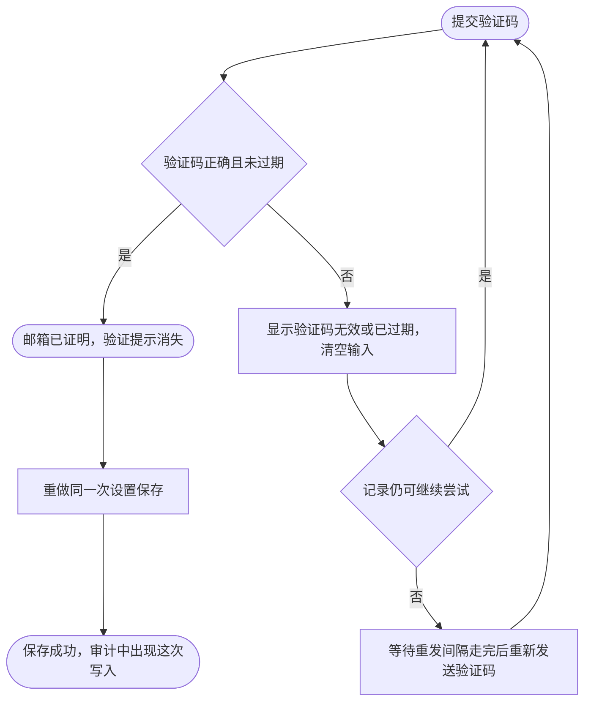

# 运营者首次登录并解除管理写入的限制

## 参与者

平台运营者：由 seed 写入的账户，持内置平台管理员角色，因此持有平台域与部署租户域的全部声明权限，能看到并进入控制台。该账户的邮箱地址已登记为邮箱标识，但尚未由本人证明。

## 前置条件

- 部署方已运行 seed：运营者账户、平台管理员角色、角色的授权与绑定，以及部署租户已写入。
- 运营者账户上的邮箱地址尚未被本人证明。
- 部署装配了可用的邮件通道，发往该地址的验证码能送达。
- 运营者持有 seed 给出的登录名与口令。
- 本旅程进行时，该部署尚无运营者经管理面做过的写入。
- 本旅程自登录起连续完成，期间运营者不会被要求重新证明身份。

## 步骤

1. 运营者用 seed 给出的登录名与口令在登录面登录，登录完成后进入产品，落在租户区首页。应用栏下方出现一条邮箱验证提示：提示写明验证该邮箱地址可以解除账户上的限制，并提供「去验证」与「更换邮箱」入口；提示没有关闭控件。

2. 运营者从页头的控制台入口进入控制台，首页的控制台卡片同样通向控制台。控制台导航按分组呈现页面，「平台配置」是其中一个分组。运营者从该分组打开设置页。设置页按命名空间分组列出本部署声明的设置项，每项给出键、类型与当前有效值；没有显式取值的项标为「默认」。

3. 运营者把其中一项设置改成另一个在本项声明范围内合法的值，点「保存改动」。这次写入被拒绝：表格下方的反馈区显示这次失败的文字，提示先到账户页验证邮箱地址再继续。刚填的值留在输入框里，该项仍标「默认」，当前有效值没有改变。

4. 运营者返回租户区，从邮箱验证提示里的「去验证」进入账户页的验证节。这次进入自动向该邮箱发送一次验证码；验证节显示验证码已发往该地址，焦点落在验证码输入框，「重新发送验证码」在等待时间内不可用，并显示还要等待的秒数。

5. 运营者从邮箱取出验证码，填入验证码字段并提交。验证通过：验证节显示该邮箱地址已完成验证，应用栏下方的验证提示消失。

6. 运营者回到控制台的设置页，重做同一次写入：同一项设置、同一个新值，点「保存改动」。这次保存成功：该项标为「已覆盖」，当前值显示为刚写入的值，反馈区给出这次保存的成功确认，先前那次失败的文字不再出现。

7. 运营者从控制台导航的「审计」打开审计记录页。记录最新在前，这次写入出现在列表靠前的位置。运营者把动作筛选与结果筛选设为这条记录的动作与成功结果并应用，列表只余这次写入。打开这条记录的详情，看到动作、对象、结果与操作者等字段，没有取值的字段显示占位符，并可从详情返回列表。

## 结果

- 运营者账户的邮箱读作已验证，应用栏下方的验证提示不再出现。
- 同一次设置写入成功：该项在设置页上标为「已覆盖」，当前值为运营者写入的值。
- 审计记录中存在这次写入：动作是设置写入，结果为成功，操作者是该运营者。

## 备选路径

分叉落在提交验证码一步：验证码错误或已过期时，提交被拒，验证节显示验证码无效或已过期的说明并清空输入，运营者可以重新输入。连续错误达到上限后这条待验证记录作废，运营者需等重发等待走完后重新发送一次验证码；记录过期同样以重新发送得到新码。两种情况都回到提交一步，邮箱证明后旅程续接主路径。

## 覆盖的需求

- `REQ-signin-006`
- `REQ-account-010`
- `REQ-account-015`
- `REQ-account-016`
- `REQ-account-017`
- `REQ-account-019`
- `REQ-account-020`
- `REQ-platform-admin-001`
- `REQ-platform-admin-017`
- `REQ-platform-admin-029`
- `REQ-platform-admin-031`
- `REQ-platform-config-001`
- `REQ-platform-config-003`
- `REQ-platform-config-005`
- `REQ-presentation-027`
- `REQ-presentation-028`
- `REQ-presentation-029`

## 端到端测试

`未实现`
