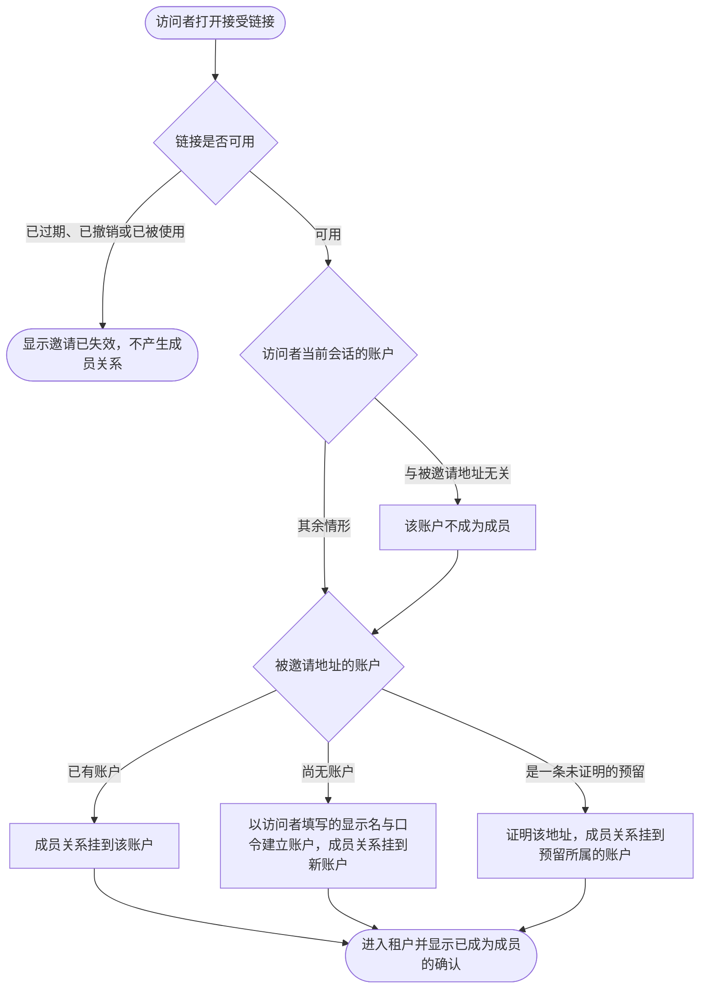

# 开通一个租户并让首位成员进入

## 参与者

平台运营者：持平台域的租户读取权限与租户管理权限，以及成员关系管理权限，账户邮箱已经证明。邀请落地一步由受邀成员在浏览器中完成；该成员是持有接受链接的访问者。

## 前置条件

- 操作者已登录，且账户邮箱已证明。
- 部署装配了租户名册管理面与邀请面，管理后台对持平台管理权限的账户开放；账户菜单中的管理后台入口与首页的管理后台卡片只对这类账户、且只在当前组织是 `system` 时出现，无平台权限的账户看不到它们。
- 主路径中，目标成员已有账户，账户的邮箱即运营者将要邀请的地址。
- 目标租户尚未登记。

## 步骤

1. 运营者以平台运营账户登录后，当前组织为 `system`；他从账户菜单中的管理后台入口或首页的管理后台卡片进入管理后台。进入后看到管理后台框架与分组导航，「租户」位于其中一个分组。
2. 运营者打开「租户」页。名册按租户标识排序列出全部租户，每行给出标识、别名与状态；一个租户也没有时页面显示空列表提示，而不是错误。
3. 运营者点「登记租户」，填写租户标识与别名并提交。提交成功后名册新增一行，状态为启用，标识与别名与填写值一致。标识已被占用或别名已被其他租户占用时，页面给出冲突提示，名册不新增行。
4. 运营者打开该租户的详情页，把别名改成另一个值并提交。提交成功后详情页与名册都显示新别名，状态保持启用。新别名已被其他租户占用时，页面给出冲突提示，别名保持原值。
5. 运营者从详情页的入口进入「邀请与成员」页，或从导航打开该页并选定这个租户。选定租户前页面不列出任何属于某个租户的数据；选定后显示该租户的成员列表与邀请列表。新建租户的成员列表包含创建者本人——运营者就是该租户的第一名成员与租户管理员；邀请列表为空。
6. 运营者在邀请区填写被邀请成员的邮箱与有效期，签发邀请。签发成功后页面列出这条待接受的邀请，包含被邀请地址、状态与有效期，并在该控件组下以只显示一次的面板给出接受链接与复制控件；面板关闭或离开页面后，链接不再显示。
7. 运营者复制接受链接，经自己的渠道交给目标成员。
8. 成员在浏览器打开链接。未登录时先看到登录面，登录后看到邀请摘要：被邀请加入的租户、被邀请的地址与有效期。
9. 成员点「接受」。接受成功后页面显示已成为该租户成员的确认，并落在该租户的租户区首页，当前租户即该租户。成员关系挂到被邀请地址对应的账户上；接受时所处的会话属于另一个账户时，该账户不成为该租户的成员。
10. 成员在账户菜单的组织行看到当前租户就是这个租户；若账户另有租户，展开组织行后列出其余租户，选中其一即切到该租户，切回时展示的数据随之切换。再次打开同一条接受链接得到邀请已失效的结果，不产生新的成员关系。
11. 运营者回到管理后台的「邀请与成员」页并刷新，看到这条邀请的状态为已接受，成员列表包含被邀请地址对应的账户。

## 结果

- 名册中存在标识与别名均为运营者所填值、状态为启用的租户。
- 该租户的邀请列表中，这条邀请为已接受。
- 该租户的成员列表包含被邀请地址对应的账户。
- 受邀成员接受后落在该租户的租户区首页，账户菜单的组织行把它显示为当前组织；展示的数据属于该租户。
- 同一条接受链接再次打开被拒，不产生第二条成员关系。

## 备选路径

分叉落在接受一步。备选路径各自的起始状态替代主路径前置条件中的「已有账户」：被邀请地址可以尚无账户，也可以是一条未证明的预留；访问者也可以正以另一个账户登录。

- 访问者以与被邀请地址无关的另一个账户登录后打开链接：接受被受理，该登录账户不成为成员，成员关系仍挂在被邀请地址上。
- 被邀请地址尚无账户：接受面提供显示名与口令两个可填输入；成员填写后接受即建立账户，该地址成为新账户的已验证邮箱，成员关系挂在新账户上。
- 被邀请地址正是一条未证明的预留：接受证明该地址，成员关系挂到预留所属的原账户，不建立第二个账户。
- 链接已过期、已被撤销或已被使用：接受被拒，页面显示邀请已失效，成员关系不产生。运营者为同一地址重新签发后，先前的链接失效，新链接可用。

## 覆盖的需求

- `REQ-platform-admin-001`
- `REQ-platform-admin-006`
- `REQ-platform-admin-010`
- `REQ-platform-admin-011`
- `REQ-platform-admin-032`
- `REQ-platform-admin-033`
- `REQ-tenancy-001`
- `REQ-tenancy-002`
- `REQ-tenancy-005`
- `REQ-tenancy-006`
- `REQ-tenancy-008`
- `REQ-tenancy-011`
- `REQ-tenancy-012`
- `REQ-tenancy-013`
- `REQ-tenancy-016`
- `REQ-tenancy-017`
- `REQ-tenancy-018`
- `REQ-tenancy-019`
- `REQ-tenancy-020`
- `REQ-tenancy-021`
- `REQ-tenancy-022`
- `REQ-tenancy-023`

## 端到端测试

`starters/demo/web/e2e/specs/journey-operator-onboards-tenant.spec.ts` `operator-onboards-tenant: an operator registers a tenant, invites its first member, and the member joins`
