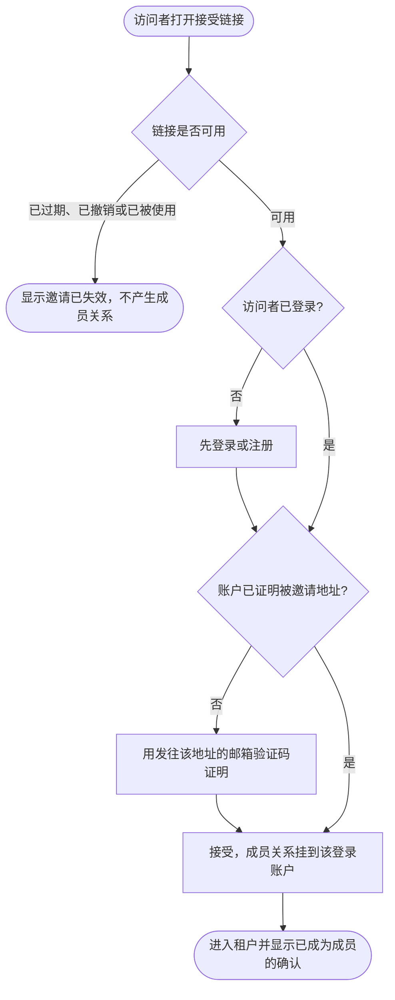

# 开通一个租户并让首位成员进入

## 参与者

平台运营者：持平台域的租户读取权限与租户管理权限，以及成员关系管理权限，账户邮箱已经证明。邀请落地一步由受邀成员在浏览器中完成；该成员是持有接受链接的访问者，也是所有权转移请求的目标，确认或拒绝由它在本人的账户级转移请求页完成。

## 前置条件

- 操作者已登录，且账户邮箱已证明。
- 部署装配了租户名册管理面与邀请面，管理后台对持平台管理权限的账户开放；账户菜单中的管理后台入口与首页的管理后台卡片只对这类账户、且只在当前组织是 `system` 时出现，无平台权限的账户看不到它们。
- 主路径中，目标成员已有账户，账户的邮箱即运营者将要邀请的地址。
- 目标租户尚未登记。

## 步骤

1. 运营者以平台运营账户登录后，当前组织为 `system`；他从账户菜单中的管理后台入口或首页的管理后台卡片进入管理后台。进入后看到管理后台框架与分组导航，“租户”位于其中一个分组。
2. 运营者打开“租户”页。名册按名称排序列出全部租户，每行给出显示名、名称与状态；一个租户也没有时页面显示空列表提示，而不是错误。
3. 运营者点“登记租户”，在独立创建页填写名称与显示名并提交；描述、联系邮箱与网站可选，内部标识不填写。提交成功后跳转到该租户的详情页，名册新增一行，状态为启用，显示名与名称与填写值一致，详情地址以名称结尾。名称已被其他租户占用时，页面给出冲突提示，名册不新增行。
4. 运营者查看该租户的详情页。摘要按顺序给出显示名、名称与状态，资料卡可编辑显示名、描述、联系邮箱与网站，创建时间只读；名称只读，页面没有改名控件，也没有内部标识。绕过界面发起的名称改名被拒绝为“名称创建后不可变”，详情页与名册的名称保持原值。
5. 运营者从详情页的入口进入“邀请与成员”页，或从导航打开该页并选定这个租户。选定租户前页面不列出任何属于某个租户的数据；选定后显示该租户的成员列表与邀请列表。新建租户的成员列表包含创建者本人：运营者就是该租户的第一名成员与租户管理员；邀请列表为空。
6. 运营者在邀请区填写被邀请成员的邮箱与有效期，签发邀请。签发成功后页面列出这条待接受的邀请，包含被邀请地址、状态与有效期，并在该控件组下以只显示一次的面板给出接受链接与复制控件；面板关闭或离开页面后，链接不再显示。
7. 运营者复制接受链接，经自己的渠道交给目标成员。
8. 成员在浏览器打开链接。未登录时先看到登录面，登录后看到邀请摘要：被邀请加入的租户、被邀请的地址与有效期。
9. 成员点“接受”。接受成功后页面显示已成为该租户成员的确认，并落在该租户的租户区首页，当前租户即该租户。成员关系挂到被邀请地址对应的账户上；接受时所处的会话属于另一个账户时，该账户不成为该租户的成员。
10. 成员在账户菜单的组织行看到当前租户就是这个租户；若账户另有租户，展开组织行后列出其余租户，选中其一即切到该租户，切回时展示的数据随之切换。再次打开同一条接受链接得到邀请已失效的结果，不产生新的成员关系。
11. 运营者回到管理后台的“邀请与成员”页并刷新，看到这条邀请的状态为已接受，成员列表包含被邀请地址对应的账户。

12. 运营者在名册中选择一个成员列表含可转移成员的租户，打开发起转移请求操作。运营者是该组织的 tenant-admin 时，对话框提供该组织的成员选择器；只持 `tenant.manage` 时提供平台账户选择器。选定 active 成员并二次确认后，请求被记录，页面给出点名该租户与目标的待处理确认，所有权不变；目标不是该组织 active 成员时被拒绝。系统向目标发出站内通知，目标在自己的账户级转移请求页确认后，名册的显示内容才变为新所有者；目标拒绝、运营者取消或请求到期时所有权不变。运营者不能代替目标确认。

13. 运营者在名册中删除一个自己登记的租户：一次确认对话框与一次加重确认之后，该行以墓碑呈现，转移请求与删除入口都不再出现；再次登记同一个名称被拒绝，名册不新增行。

## 结果

- 名册中存在显示名与名称均为运营者所填值、状态为启用的租户；内部标识不出现在名册、详情页或地址栏。
- 该租户的邀请列表中，这条邀请为已接受。
- 该租户的成员列表包含被邀请地址对应的账户。
- 受邀成员接受后落在该租户的租户区首页，账户菜单的组织行把它显示为当前组织；展示的数据属于该租户。
- 同一条接受链接再次打开被拒，不产生第二条成员关系。
- 平台运营者可以发起租户的所有者转移请求并删除租户；发起给出点名目标的待处理确认，目标确认后名册显示新所有者；目标拒绝、取消或到期时所有权不变。删除后该行以墓碑呈现、入口消失，删除的名称不能再次登记。

## 备选路径

分歧点落在接受一步。被邀请地址可以已有账户，也可以尚无账户；无论哪种，接受都不建立账户，并要求已登录账户自己证明该地址。访问者也可以正以另一个账户登录。

- 访问者以已证明被邀请地址的账户打开链接：接受成立，成员关系挂到该登录账户。
- 账户未证明被邀请地址，或只证明了另一个地址：接受被拒绝，页面给出证明指引，邀请保持待接受；用发往被邀请地址的验证码证明后，接受成立。
- 被邀请地址尚无账户：接受不建立账户；当事人先注册或登录、证明该地址，再回到链接接受。
- 链接已过期、已被撤销或已被使用：接受被拒，页面显示邀请已失效，成员关系不产生。运营者为同一地址重新签发后，先前的链接失效，新链接可用。

## 覆盖的需求

- `REQ-platform-admin-001`
- `REQ-platform-admin-006`
- `REQ-platform-admin-010`
- `REQ-platform-admin-011`
- `REQ-platform-admin-032`
- `REQ-platform-admin-033`
- `REQ-platform-admin-050`
- `REQ-platform-admin-051`
- `REQ-platform-admin-055`
- `REQ-platform-admin-058`
- `REQ-platform-admin-118`
- `REQ-tenancy-001`
- `REQ-tenancy-002`
- `REQ-tenancy-005`
- `REQ-tenancy-006`
- `REQ-tenancy-008`
- `REQ-tenancy-011`
- `REQ-tenancy-012`
- `REQ-tenancy-013`
- `REQ-tenancy-016`
- `REQ-tenancy-017`
- `REQ-tenancy-018`
- `REQ-tenancy-019`
- `REQ-tenancy-020`
- `REQ-tenancy-021`
- `REQ-tenancy-022`
- `REQ-tenancy-023`
- `REQ-tenancy-061`
- `REQ-tenancy-062`
- `REQ-tenancy-064`
- `REQ-tenancy-066`
- `REQ-tenancy-067`
- `REQ-tenancy-068`
- `REQ-tenancy-069`
- `REQ-tenancy-070`
- `REQ-tenancy-072`
- `REQ-tenancy-073`
- `REQ-tenancy-074`
- `REQ-tenancy-075`

## 端到端测试

`starters/demo/web/e2e/specs/journey-operator-onboards-tenant.spec.ts` `operator-onboards-tenant: an operator registers a tenant, invites its first member, and the member joins`；所有权转移请求与目标确认的端到端用例未实现，由后端用例 `pkg/tenant/ownership/request_test.go` 与组件用例 `web/packages/admin-ui/src/internal/tenant-lifecycle.test.tsx` 覆盖；`operator-onboards-tenant: the operator deletes a tenant and its name cannot be reused`（删除与墓碑、名称不可复用）。平台详情页的资料编辑由 `web/packages/admin-ui/src/TenantDetailPage.test.tsx` 覆盖。
