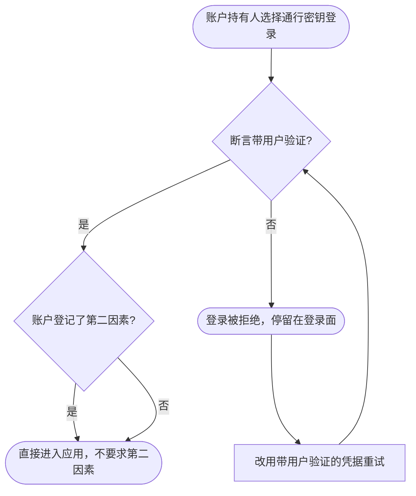

# 用带用户验证的通行密钥登录，不再要求第二因素

## 参与者

- 账户持有人。

## 前置条件

- 账户已启用。
- 已登记一枚可发现通行密钥（[REF-webauthn](../../references.md)），且该认证器能完成用户验证。
- 账户另已登记一种两步验证方式，因此「不再要求第二因素」可被观察。
- 当前未登录。

## 步骤

1. 账户持有人在登录面选择通行密钥入口。
2. 浏览器以带用户验证的方式完成凭据仪式。
3. 直接进入应用；界面不出现第二因素步骤，也不列出两步验证方式。
4. 账户持有人退出后，改用不带用户验证的凭据再试。
5. 登录被拒绝，停留在登录面并给出失败文案。

## 结果

- 带用户验证的通行密钥断言单独完成登录，第一因素本身已证明两类因素，第二因素不再被要求。
- 不带用户验证的断言不完成登录。

## 备选路径

- **账户只登记了通行密钥、没有第二因素**：同样一条仪式即进入应用，不因缺少第二因素而被要求登记。
- **不带用户验证的断言被拒后**：可用带用户验证的断言重试并成功。

## 覆盖的需求

- 账户安全：`REQ-security-008`、`REQ-security-039`
- 登录：`REQ-signin-024`

## 端到端测试

`starters/demo/web/e2e/specs/journey-passkey-user-verification.spec.ts` `passkey-user-verification: a user-verifying passkey signs in without a second factor`
