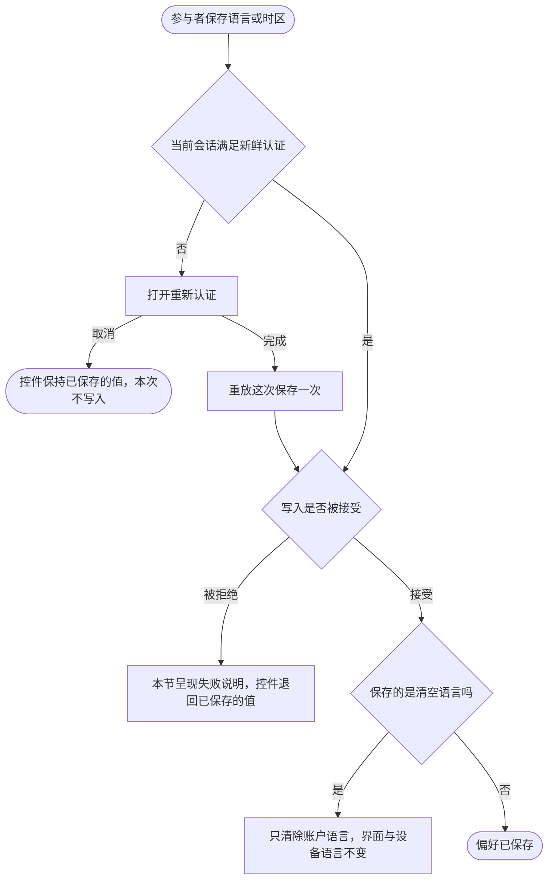

# 按偏好调整界面

## 参与者

终端用户：已登录的账户持有人，使用租户区与本人的账户设置，不持有平台管理权限。

## 前置条件

- 参与者的账户处于启用状态并已登录，账户设置页可以打开。
- 本部署在装配期把外壳形态选定为侧栏形态，并选定了一个默认主题预设；本部署携带的主题预设清单与可呈现的语言集合都包含当前值之外的其他值。
- 这台设备上还没有记录主题预设、明暗模式与人工选择的语言，界面因此按部署的默认主题预设、系统明暗偏好与浏览器语言偏好开始。
- 浏览器声明的语言偏好与参与者随后选择的语言不同，部署的默认主题预设与参与者随后选择的预设也不同。

## 步骤

1. 参与者打开账户设置页。参与者所见各页面此时按部署的默认主题预设呈现；外观一节列出本部署携带的主题预设，名称以当前界面语言显示；偏好设置一节的语言与时区都停在一个标为「未选择」的选项上。
2. 参与者在外观一节选择一个与当前不同的主题预设。参与者所见各页面立即按新预设呈现，没有确认步骤，也不需要整页刷新。
3. 参与者在租户区的各页面之间浏览。外壳保持本部署选定的侧栏形态，跨页面不变；在桌面宽度下把侧栏收起为仅图标的窄栏，再展开。收起后每个入口仍能通过提示或可及名得知它的标签。
4. 参与者在页头切换明暗模式。界面立即换成另一种明暗，主题预设保持不变。
5. 参与者打开页头语言菜单。菜单列出本部署能够呈现的每一种语言且不列出其他语言，选项以当前界面语言显示，当前语言处于选中。
6. 参与者改在账户设置的偏好设置一节把语言从当前语言改成另一种并保存。保存成功后，本节给出点名语言这一偏好的保存确认；页面文案、导航与浏览器标签标题立即以新语言呈现，不需要整页刷新。
7. 参与者在同一节把时区从一个「未选择」项改成一个与设备时区不同的可用时区并保存，本节给出点名时区这一偏好的保存确认。时区下拉除可用的时区清单外，始终保留一个标为「未选择」的选项。
8. 参与者打开账户设置的「登录会话」一节。当前会话一行给出登录时间与上次活跃时间，这些时间按刚选定的时区显示，并按当前界面语言格式化。
9. 参与者刷新整个页面。参与者所见各页面仍按所选主题预设与明暗模式呈现，界面语言仍是所选语言，登录会话中的时间仍按所选时区显示；账户设置的语言与时区仍显示为已保存的值。

## 结果

- 参与者所见各页面按所选主题预设与明暗模式呈现；租户区的外壳是部署选定的侧栏形态，跨页面保持一致，收起为窄栏后仍可展开，收起态下每个入口的标签仍可被感知。
- 界面语言是所选语言，导航、页面文案与浏览器标签标题都随之切换，日期与时间按该语言格式化。
- 账户页的会话时间按账户保存的时区显示，与设备时区不同。
- 刷新后以上选择全部保持：主题预设与明暗模式从这台设备恢复，界面语言仍是人工选择的那一种而不是浏览器偏好的那一种，账户设置里语言与时区仍是已保存的值。
- 主题预设、明暗模式与语言都在选择之后立即生效，不需要整页刷新或确认步骤。

## 备选路径

**会话不满足新鲜认证。** 保存语言或时区时，若当前会话不具备新鲜认证，这次保存不直接发生，页面打开重新认证。完成重新认证后，系统自动按原样重放这次保存一次，得到与直接保存相同的成功确认；取消重新认证时这次保存不重放，控件保持已保存的值。

**保存被拒绝。** 保存失败时，失败说明呈现在偏好设置一节内，语言与时区控件退回已保存的值，本次未保存的选择不保留。

**清空账户语言。** 把语言选回「未选择」并保存成功后，只清除账户上的语言偏好；界面语言与这台设备上的人工选择都不改变，界面仍以这台设备当前的语言呈现。

## 覆盖的需求

- `REQ-account-003`
- `REQ-account-004`
- `REQ-account-030`
- `REQ-presentation-002`
- `REQ-presentation-003`
- `REQ-presentation-004`
- `REQ-presentation-005`
- `REQ-presentation-006`
- `REQ-presentation-007`
- `REQ-presentation-008`
- `REQ-presentation-010`
- `REQ-presentation-011`
- `REQ-presentation-012`
- `REQ-presentation-013`
- `REQ-presentation-015`
- `REQ-presentation-016`
- `REQ-presentation-018`
- `REQ-presentation-030`

## 端到端测试

`未实现`
