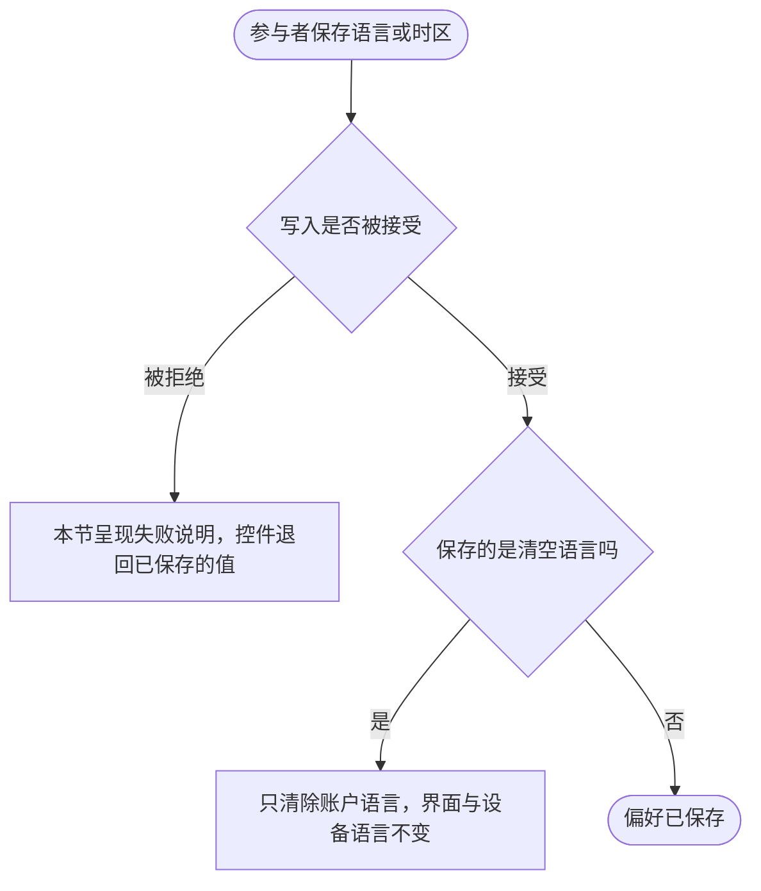

# 按偏好调整界面

## 参与者

终端用户：已登录的账户持有人，使用本人的账户设置，不持有平台管理权限。

## 前置条件

- 账户处于启用状态并已登录，账户设置页可以打开。
- 账户上还没有保存语言与时区偏好。
- 本部署能够呈现的语言集合包含参与者随后选择的语言，时区清单包含参与者随后选择的时区。
- 浏览器声明的语言偏好与参与者随后选择的语言不同，设备时区与参与者随后选择的时区不同。

## 步骤

1. 参与者打开账户设置的“偏好”页。语言与时区两个下拉都停在一个标为“未选择”的选项上；时区下拉除可用的时区清单外始终保留该选项。
2. 参与者把语言从“未选择”改成另一种语言并保存。保存成功后，本页给出点名语言这一偏好的保存确认；页面文案、导航与浏览器标签标题立即以新语言呈现，不需要整页刷新。
3. 参与者把时区从“未选择”改成一个与设备时区不同的可用时区并保存。本页给出点名时区这一偏好的保存确认。
4. 参与者打开“登录会话”页。会话表给出一次最近活动与地址，这些时间按刚选定的时区显示，并按当前界面语言格式化。
5. 参与者刷新整个页面。界面语言仍是所选语言，账户设置的语言与时区仍显示为已保存的值，“登录会话”中的时间仍按所选时区显示。

## 结果

- 账户存下所选的语言与时区；界面语言是所选语言，导航、页面文案与浏览器标签标题都随之切换，日期与时间按该语言格式化。
- 账户页的会话时间按账户保存的时区显示，与设备时区不同。
- 刷新后以上选择全部保持：界面语言仍是人工选择的那一种而不是浏览器偏好的那一种，账户设置里语言与时区仍是已保存的值。

## 备选路径

**保存直接写入**。 保存语言或时区不要求重新验证身份（REQ-account-058）：这次保存直接写入并得到成功确认，不打开重新认证，也没有被拒绝后的一次重放。

**保存被拒绝**。 保存失败时，失败说明呈现在“偏好”页内，语言与时区控件退回已保存的值，本次未保存的选择不保留。

**清空账户语言**。 把语言选回“未选择”并保存成功后，只清除账户上的语言偏好；界面语言与这台设备上的人工选择都不改变，界面仍以这台设备当前的语言呈现。

## 覆盖的需求

- `REQ-account-003`
- `REQ-account-004`
- `REQ-account-058`
- `REQ-account-033`
- `REQ-account-034`
- `REQ-security-022`
- `REQ-presentation-003`
- `REQ-presentation-004`
- `REQ-presentation-005`
- `REQ-presentation-006`
- `REQ-presentation-007`
- `REQ-presentation-008`
- `REQ-presentation-010`
- `REQ-presentation-030`

## 端到端测试

`starters/demo/web/e2e/specs/journey-personalize-interface.spec.ts` `personalize-interface: the chosen language and time zone take effect and survive a reload`
