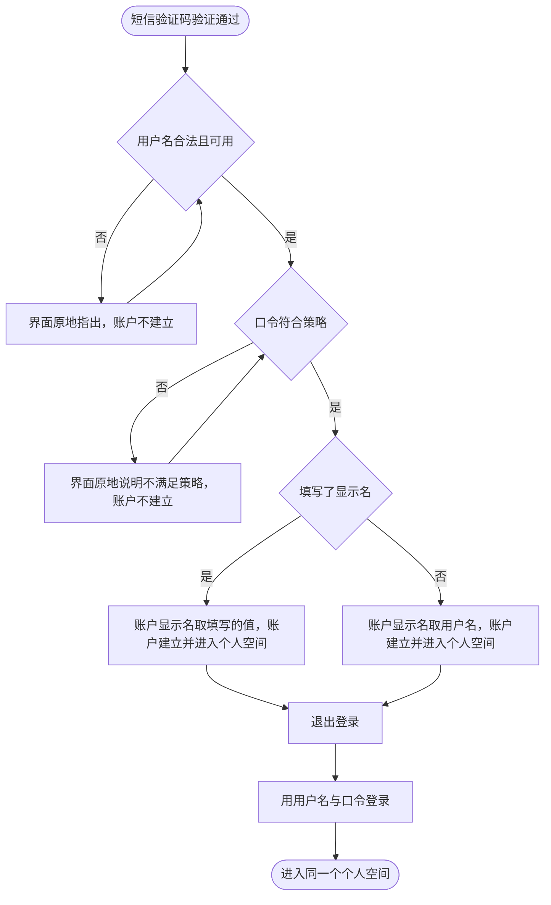

# 短信首登开户到口令登录

## 参与者

尚无本产品账户的新用户，是终端使用者，不持有平台管理权限。开户时选定用户名、可选的显示名、口令与确认口令；开户后账户以手机号与用户名登录，也立即可以用用户名与口令登录同一账户。

## 前置条件

- 该部署开放短信首登开户，并装配了短信验证码登录方式与可用的短信载体，因此登录页出现短信渠道。
- 参与者拟使用的手机号前缀在该部署允许的国家或地区范围内，且该号码尚未与本产品的任何账户关联。
- 参与者能在该手机上接收短信验证码。
- 该部署启用了个人空间特性，并为尚无其他成员关系的账户建立个人租户，因此短信开户后账户会获得一个个人空间，租户区首页可用。
- 参与者不属于任何组织。

## 步骤

1. 在未登录状态下打开产品，界面呈现登录面；短信渠道下有一句说明，指出未登记的手机号会创建账户。该说明对所有号码一致，不因号码是否已登记而改变。

2. 选择国家或地区，填写手机号，点「发送验证码」。界面提示验证码已发送至该号码，并出现验证码输入框。

3. 输入收到的验证码并提交。验证通过后，界面要求填写一个用户名（必填）、一个可选的显示名、一个口令与确认口令（必填）；账户尚未建立。

4. 填写一个合法且未被占用的用户名、一个可选的显示名、一个符合口令策略的口令并再次输入确认；提交后账户随即建立，显示名取填写的值，界面进入租户区首页：页头的组织切换器把当前组织显示为「个人空间」，打开切换器时列表里只有这个个人空间，当前组织那一项不可被选中。本旅程的部署启用了个人空间特性，因此落点是租户区首页；未启用该特性的部署按 REQ-signup-052 落在账户页。

5. 通过账户菜单退出登录。界面回到登录面。

6. 在登录面使用「邮箱或用户名」与「密码」的口令表单，输入开户时选定的用户名与口令，提交。登录成功，进入同一个「个人空间」。

## 结果

- 账户同时具备手机号与口令两条登录途径：手机号仍可用于短信验证码登录，用户名与口令可用于口令登录，两种方式进入同一个账户与同一个「个人空间」。
- 账户的登录方式列表列出开户所用的手机号与开户时选定的用户名；该手机号既作联系方式也作登录方式，账户没有默认联系地址。
- 账户的显示名等于开户时填写或留空所决定的值，留空时取本次选定的用户名。
- 开户后落在租户区首页；本旅程的部署启用了个人空间特性，因此账户直接以开户时取得的用户名与口令可用，个人空间是当前组织。

## 备选路径

开户一步被拒时，账户不建立：填写的用户名不合法、是保留字或已被占用时，界面在原地指出，参与者改填另一个用户名后账户才建立。

口令被拒时，账户同样不建立：口令不满足策略时，界面在原地说明不满足策略而不写出具体数值，参与者改填合格口令后账户才建立。

显示名可以留空：留空时账户照常建立，显示名取本次选定的用户名；开户后的页面与后续步骤与主路径相同。

## 覆盖的需求

- `REQ-signup-012`
- `REQ-signup-014`
- `REQ-signup-015`
- `REQ-signup-051`
- `REQ-signup-052`
- `REQ-signin-006`
- `REQ-signin-011`
- `REQ-account-007`
- `REQ-account-060`
- `REQ-account-061`
- `REQ-security-030`
- `REQ-tenancy-022`
- `REQ-tenancy-026`

## 端到端测试

`starters/demo/web/e2e/specs/journey-sms-signup-to-password-login.spec.ts` `sms-signup: a phone-code first sign-in becomes a username-and-password login`；`sms-signup: a phone-code first sign-in with no display name takes the username`
