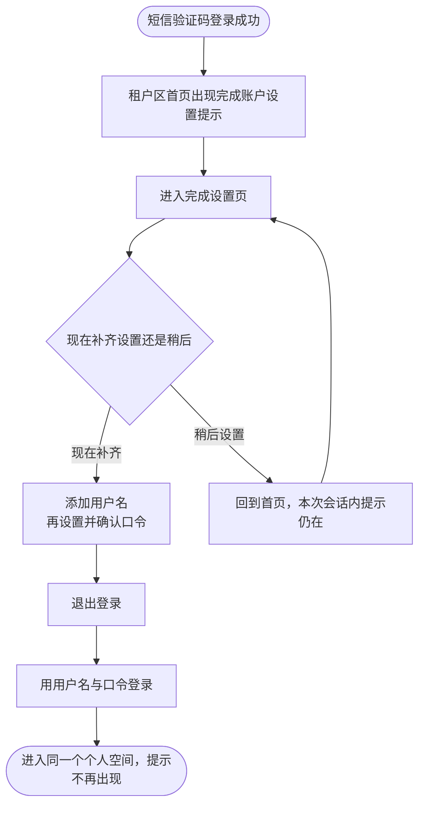

# 短信首登开户到改用口令登录

## 参与者

尚无本产品账户的新用户，是终端使用者，不持有平台管理权限。开户后，账户先只以手机号登录；补齐用户名与口令之后，以同一账户继续使用。

## 前置条件

- 该部署开放短信首登开户，并装配了短信验证码登录方式与可用的短信载体，因此登录页出现短信渠道。
- 参与者拟使用的手机号前缀在该部署允许的国家或地区范围内，且该号码尚未与本产品的任何账户关联。
- 参与者能在该手机上接收短信验证码。
- 该部署启用了个人空间特性，并为尚无其他成员关系的账户建立个人租户，因此短信开户后账户会获得一个个人空间，租户区首页可用。
- 参与者不属于任何组织。

## 步骤

1. 在未登录状态下打开产品，界面呈现登录面；短信渠道下有一句说明，指出未登记的手机号会创建账户。该说明对所有号码一致，不因号码是否已登记而改变。

2. 选择国家或地区，填写手机号，点「发送验证码」。界面提示验证码已发送至该号码，并出现验证码输入框。

3. 输入收到的验证码并提交。验证通过后，界面进入租户区首页：页头的组织切换器把当前组织显示为「个人空间」，打开切换器时列表里只有这个个人空间，当前组织那一项不可被选中；首页顶部出现「完成账户设置」提示，带有一个关闭控件和一个进入完成设置页的链接。

4. 参与者用另一台设备以手机号与验证码登录同一账户，使那台设备上也保持一个活跃会话。

5. 点提示里的链接进入完成设置页。页面先呈现添加用户名的入口；登录标识列表里目前只有手机号，且其归属显示为已验证。口令一节此时只给出说明：口令登录需要先有登录名，因此不显示口令表单。

6. 在用户名一处填入一个未被占用的用户名并提交。该用户名出现在登录标识列表中；口令表单随之出现，页面不需要整页刷新。

7. 填写新口令并再次输入确认，提交；此处不要求提交当前口令。成功后页面确认口令已设置，并说明其他设备已被退出登录；页面转为「账户设置已完成」，说明此后可以用用户名和口令登录，并提供回到首页的入口。

8. 点回到首页。首页的「完成账户设置」提示不再出现。

9. 通过账户菜单退出登录。界面回到登录面。

10. 在登录面使用「邮箱或用户名」与「密码」的口令表单，输入刚设置的用户名与口令，提交。登录成功，进入同一个「个人空间」；首页不再出现完成设置提示。

## 结果

- 账户同时具备手机号与口令两条登录途径：手机号仍可用于短信验证码登录，用户名与口令可用于口令登录，两种方式进入同一个账户与同一个「个人空间」。
- 账户的登录标识列表同时列出归属已验证的手机号与新添加的用户名。
- 账户设置已完成，首页的「完成账户设置」提示不再出现，重新登录后同样不出现。
- 该账户在另一台设备上的会话已结束，那台设备的下一次请求被要求重新登录。

## 备选路径

完成设置页提供「稍后设置」出口，参与者可以暂不补齐用户名与口令。此时账户保持只有手机号一条登录途径：选择「稍后设置」后回到首页，本次登录会话内提示在未被关闭且设置未完成时继续出现；提示的关闭只对本次身份会话生效。参与者可以再次从该提示进入完成设置页，从添加用户名继续主路径。

## 覆盖的需求

- `REQ-signup-012`
- `REQ-signup-014`
- `REQ-signup-015`
- `REQ-signin-006`
- `REQ-signin-011`
- `REQ-signin-012`
- `REQ-signin-014`
- `REQ-signin-030`
- `REQ-account-007`
- `REQ-account-008`
- `REQ-account-012`
- `REQ-account-013`
- `REQ-account-021`
- `REQ-account-022`
- `REQ-account-023`
- `REQ-account-026`
- `REQ-security-029`
- `REQ-security-030`
- `REQ-tenancy-022`
- `REQ-tenancy-026`

## 端到端测试

`starters/demo/web/e2e/specs/journey-sms-signup-to-password-login.spec.ts` `sms-signup: a phone-code first sign-in becomes a username-and-password login`
