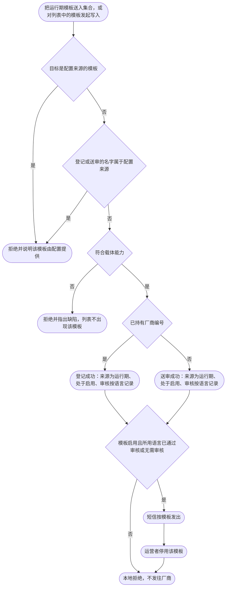

# 上线一条短信模板并投入发送

## 参与者

平台运营者：持平台域的短信模板读取权限与写入权限，能在控制台打开短信模板页、查看模板列表、登记模板、提交审核、启停与移除运行期模板，并能读取该部署的运行日志（出站发送以进程日志记录）。该运营者同时持有一个测试组织的成员关系，可以在租户区完成会派发通知的业务动作。

## 前置条件

- 本次部署装配了短信注册表与恰好一个短信载体，载体可用。
- 发送总开关处于开启。
- 配置来源声明了模板，列表中可以观察到配置来源的只读表现。
- 本次部署已声明一个通知类型，其默认渠道包含短信；该类型的短信模板名指向本次要送入的模板，并声明了收件人可见参数白名单。
- 测试组织中存在一名收件人账户，其手机号已验证，可作为短信目的地。
- 运营者在测试组织中能完成会派发该类型通知的业务动作。

## 步骤

1. 运营者从控制台导航打开短信模板页。页面列出模板，每行给出名称、来源、语言、审核状态与是否可发送。来自配置来源的行把来源标为配置，不记审核状态；行上的启用、停用与移除控件仍在，对这些控件发起写入会被拒绝并说明该模板来自配置。

2. 运营者在「登记模板」中填入名称、参数名与按语言的厂商编号并提交。页面给出点名该模板的成功确认，列表新增该模板：来源为运行期，处于启用；经登记进入的语言从待审核开始，载体不逐模板审核时显示为无需审核。

3. 运营者等待厂商的审核结果并刷新列表。各语言的审核状态分别显示：已通过的语言标为已通过，仍在等待的语言标为待审核；厂商改变一个语言的结果后，只有该语言的状态变化，其他语言保持原状态。

4. 运营者确认用于发送的语言已通过审核，或显示为无需审核，并确认该模板处于启用。启用与审核互不推导：该模板也可以在过审前被停用、过审后再启用；启用本身不改变任何语言的审核状态。

5. 运营者在测试组织里完成一次会派发该类型通知的业务动作。派发完成后，收件人的手机收到一条短信：内容是该模板在收件人语言下的文案，参数按模板声明的参数名填入。该部署的进程日志中出现一条成功的出站发送记录，含结果归类、耗时与厂商回执标识，不含正文与收件地址。

6. 运营者回到短信模板页，对该模板点「停用」。页面确认该模板已停用发送；列表中该行显示为不可发送，各语言的审核状态保持不变。

7. 运营者在测试组织里再次完成同一业务动作。这次该模板的短信在本地被拒绝，没有发往厂商：收件人的手机没有收到这条短信；该部署的进程日志中出现一条失败的出站发送记录，带本地拒绝的归类，且不含正文与收件地址。

## 结果

- 运行期模板出现在列表，来源为运行期且处于启用；审核状态按语言分别显示，并随厂商结果更新而各语言独立变化。
- 用于发送的语言为已通过或无需审核、且模板处于启用时，使用该模板的短信按收件人的语言发出，参数按模板声明填入。
- 模板停用后，使用该模板的短信在本地被拒绝，不再发往厂商；收件人没有收到这条短信。
- 成功与失败都落在该部署的进程日志中，记录不含正文与收件地址。

## 备选路径

- 尚无厂商编号时：在「提交审核」中填入名称、用途、语言、参数、备注与正文并提交，页面给出点名该模板的成功确认，列表新增该模板；送审的语言从待审核开始，载体不逐模板审核时不调用厂商，只在本地记录正文。
- 模板不符合本部署挂载载体的能力，例如逐模板审核的载体缺少某语言的编号、登记标识出现载体不允许的键、正文超过载体给出的长度上界：登记或送审被拒绝并指出缺陷，列表不出现该模板。
- 用配置来源模板的名字登记或送审，或对配置来源的模板尝试修改、删除、停用：写入被拒绝并说明该模板由配置提供，配置来源的模板保持不变。
- 厂商驳回或撤回某个语言的审核：该语言显示为已驳回或已撤回；以该语言发送会被本地拒绝，直到该语言重新过审。

## 覆盖的需求

- 平台配置：`REQ-platform-config-010`、`REQ-platform-config-011`、`REQ-platform-config-012`、`REQ-platform-config-013`、`REQ-platform-config-014`、`REQ-platform-config-015`、`REQ-platform-config-016`
- 通知：`REQ-notifications-021`、`REQ-notifications-023`
- 界面反馈：`REQ-presentation-027`、`REQ-presentation-028`

## 端到端测试

`未实现`
