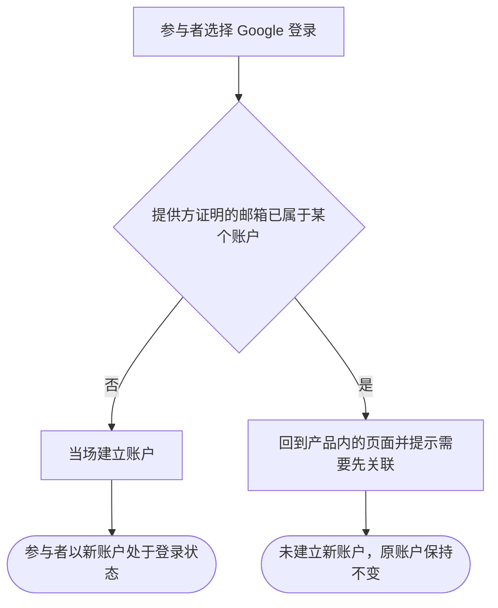

# 社交登录开户

## 参与者

参与者：终端使用者，持有一个 Google 账号，账号邮箱由提供方声明为已验证。主路径上该使用者尚无本产品账户；备选路径上该邮箱已属于一个现有账户。

参与者为终端使用者，不持有平台管理权限。

## 前置条件

- 部署装配启用了 Google 与 GitHub 社交登录，提供方都已登记本部署的回调地址。
- 社交首登开户处于开放状态，自动关联保持关闭。
- 新用户的 Google 账号由提供方声明其邮箱已验证，该邮箱不属于任何已有账户。

## 步骤

1. 新用户在登录页看到 Google 与 GitHub 的社交登录入口，选择 Google。
2. 浏览器跳到 Google 的授权页；新用户同意授权后回到产品。
3. 新用户以一个新账户的身份处于登录状态，回到产品页面，没有被要求验证邮箱。
4. 新用户打开账户页，个人资料里的邮箱就是 Google 账号的地址，邮箱验证一节显示已完成。

## 结果

- 新用户得到一个可用的账户，账户邮箱是提供方声明并已证明的地址，邮箱验证状态读作已证明，无需另行验证。
- 该账户此后仍可用同一个 Google 账号直接登录，进入的就是这个账户。

## 备选路径

同一个社交登录入口按邮箱归属分叉：提供方证明的邮箱已属于某个账户时，参与者不被允许登录该账户，也不当场开户，而是被送回产品内的页面，看到提示：该社交账号还没有关联到产品账户，需要先用原有方式登录，再到账户设置里完成关联。绑定本身不在本路径内。

- 没有建立新账户，也没有签入任何账户；被命中的账户及其登录方式保持不变。

## 覆盖的需求

- `REQ-account-015`
- `REQ-account-016`
- `REQ-signin-015`
- `REQ-signin-017`
- `REQ-signin-027`
- `REQ-signin-028`
- `REQ-signup-017`
- `REQ-signup-019`

## 端到端测试

`未实现`
