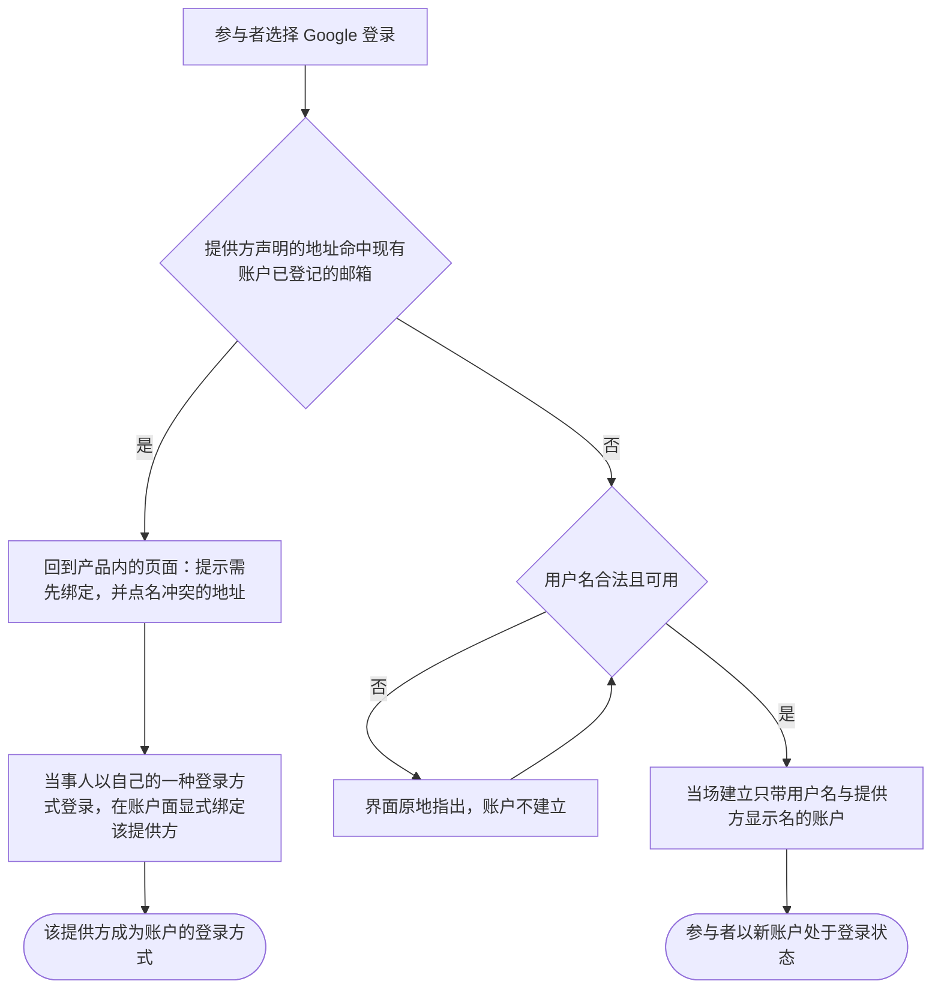

# 社交登录开户

## 参与者

参与者：终端使用者，持有一个 Google 账号，账号邮箱由提供方声明为已验证。主路径上该使用者尚无本产品账户；备选路径上该地址已登记在一个现有账户上。

参与者为终端使用者，不持有平台管理权限。

## 前置条件

- 部署装配启用了 Google 与 GitHub 社交登录，提供方都已登记本部署的回调地址。
- 社交首登开户处于开放状态。
- 新用户的 Google 账号由提供方声明其邮箱已验证，该地址没有登记在任何已有账户上。

## 步骤

1. 新用户在登录页看到 Google 与 GitHub 的社交登录入口，选择 Google。
2. 浏览器跳到 Google 的授权页；新用户同意授权后回到产品。
3. 回到产品后，界面要求先填写一个用户名，账户尚未建立。
4. 填写一个合法且未被占用的用户名并提交；账户随即建立，新用户以这个新账户的身份处于登录状态，没有被要求验证邮箱。
5. 新用户打开账户页：资料只有提供方给出的显示名，没有邮箱；联系方式为空；登录方式里列出开户时选定的用户名与这次使用的 Google 身份；账户没有邮箱，因此不显示邮箱验证一节。

## 结果

- 新用户得到一个可用的账户：账户只带提供方给出的显示名与开户前选定的用户名；提供方声明的地址没有写进账户，既不是联系方式，也不是登录方式；邮箱验证状态读作不适用。
- 该账户此后仍可用同一个 Google 账号直接登录，进入的就是这个账户；Google 身份是账户的一条登录方式。

## 备选路径

同一个社交登录入口按提供方声明的地址是否命中现有账户已登记的邮箱分叉，并在建账前要求用户名：命中时，参与者不被允许登录该账户，也不当场开户，而是被送回产品内的页面，看到需先绑定的提示：该地址已属于一个现有账户，提示同时点名那个地址（只显示足以认出的位数）。当事人以自己的一种登录方式登录后，在账户面的登录方式中显式绑定该提供方；绑定完成后该提供方成为其登录方式。

- 没有建立新账户，也没有签入任何账户；被命中的账户及其登录方式保持不变。
- 用户名为保留字、不符合格式规则或已被占用：界面在原地指出，账户不建立，参与者改填另一个用户名后账户才建立；地址是否命中现有账户的判定不受影响。

## 覆盖的需求

- `REQ-account-015`
- `REQ-account-016`
- `REQ-account-038`
- `REQ-account-060`
- `REQ-account-061`
- `REQ-account-067`
- `REQ-signin-015`
- `REQ-signin-017`
- `REQ-signin-027`
- `REQ-signin-028`
- `REQ-signin-033`
- `REQ-signin-035`
- `REQ-signin-038`
- `REQ-signup-045`
- `REQ-signup-046`
- `REQ-signup-047`
- `REQ-signup-048`
- `REQ-signup-049`

## 端到端测试

未实现。既有用例 `social-sign-in: a first Google sign-in opens an account with the provider-verified email` 仍断言新账户带提供方已证明的邮箱；`social-sign-in: a Google email already on an account is refused with link-required` 仍覆盖需先绑定的拒绝。
