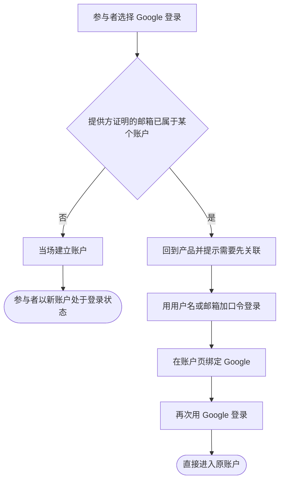

# 社交登录开户与已有账户的绑定

## 参与者

新用户：尚无本产品账户的终端使用者，持有一个 Google 账号，账号邮箱由提供方声明为已验证。备选路径由另一类参与者走完：已有口令账户的用户，已经以用户名或邮箱加口令使用本产品，账户邮箱的归属已通过自助验证证明，并持有一个使用同一邮箱的 Google 账号。

参与者均为终端使用者，不持有平台管理权限。

## 前置条件

- 部署装配启用了 Google 与 GitHub 社交登录，提供方都已登记本部署的回调地址。
- 社交首登开户处于开放状态（`authn.account.signup` 为 `open`），自动关联保持关闭（`authn.account.auto-link` 为 `never`）。
- 新用户的 Google 账号由提供方声明其邮箱已验证，该邮箱不属于任何已有账户。
- 备选路径中已有账户处于启用状态，其邮箱标识的归属已被证明，此前没有绑定任何 Google 身份，该 Google 身份也没有绑定到其他账户。

## 步骤

1. 新用户在登录页看到 Google 与 GitHub 的社交登录入口，选择 Google。
2. 浏览器跳到 Google 的授权页；新用户同意授权后回到产品。
3. 新用户以一个新账户的身份处于登录状态，回到产品页面，没有被要求验证邮箱。
4. 新用户打开账户页，个人资料里的邮箱就是 Google 账号的地址，邮箱验证一节显示已完成。

## 结果

- 新用户得到一个可用的账户，账户邮箱是提供方声明并已证明的地址，邮箱验证状态读作已证明，无需另行验证。
- 该账户此后仍可用同一个 Google 账号直接登录，进入的就是这个账户。

## 备选路径

同一个社交登录入口按邮箱归属分叉：提供方证明的邮箱已属于某个账户时，登录不被允许，该参与者转入先用口令登录、再到账户设置里绑定的分支；没有命中任何账户时当场开户，即主路径。

已有口令账户的用户走完这一分支的过程：

1. 该用户在登录页选择 Google，并在授权页同意后回到产品。
2. 该用户没有被直接签入，而是被送回产品内的页面，看到提示：该社交账号还没有关联到产品账户，需要先用原有方式登录，再到账户设置里完成关联。
3. 该用户改用用户名或邮箱加口令登录，进入原来的账户。
4. 该用户打开账户页的「绑定的社交账号」一节：已绑定列表中没有 Google；可绑定的渠道提供 Google 以及本部署启用且尚未绑定的其他社交渠道，已经绑定的渠道不再出现在可绑定渠道中。
5. 该用户选择 Google 发起绑定，浏览器跳到 Google 的授权页；同意后回到产品，界面显示正在完成绑定，随后回到账户页，已绑定列表中出现该 Google 账号。绑定过程没有让该用户退出登录或切换到别的账户。
6. 该用户退出登录，再次在登录页选择 Google，同意授权后直接进入原来的账户，不再出现关联提示。
7. 该用户退出后用用户名或邮箱加口令登录，同样进入原来的账户。

这一分支的结果：

- 已有口令账户在完成绑定后可以直接用 Google 登录进入原账户，登录时不再出现关联提示。
- 绑定的发生没有接管或合并任何账户：该用户在绑定之前用 Google 登录时被拒绝，账户内容未被改动。
- 原有的口令登录方式在绑定前后都可用，进入的都是同一个账户。

## 覆盖的需求

- `REQ-account-015`
- `REQ-account-016`
- `REQ-account-027`
- `REQ-account-028`
- `REQ-signin-006`
- `REQ-signin-015`
- `REQ-signin-017`
- `REQ-signin-027`
- `REQ-signin-028`
- `REQ-signup-017`
- `REQ-signup-019`

## 端到端测试

`未实现`
