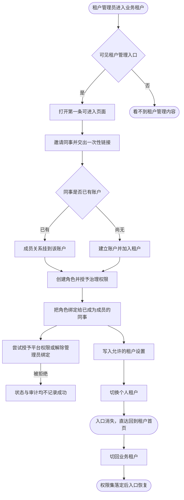

# 租户管理员接管一个业务租户的日常管理

## 参与者

- **租户管理员**：一个业务租户的成员，在该租户域持有 `tenant-admin` 角色，不持有任何平台域权限。该账户另有一个在加入业务租户之前取得的个人租户。
- **受邀同事**：被邀请加入该业务租户的同事。可以是已有账户，也可以在系统中尚无账户。
- **普通成员**：该业务租户的一名成员，不持有任何覆盖租户管理页面的权限。

## 前置条件

- 目标业务租户已登记且处于启用状态，租户管理员是该租户的有效成员。
- 本部署装配了成员与邀请、企业身份提供方、租户设置与租户角色页面。
- 租户管理员的邮箱已证明。
- 租户管理员在该业务租户持有成员与邀请、租户设置与租户角色相关的治理权限。
- 该业务租户当前只有租户管理员一条租户管理员绑定。
- 受邀同事的邮箱可由租户管理员取得；该同事尚未成为该业务租户的成员。
- 该业务租户另有一名普通成员，不持有任何覆盖租户管理页面的权限。

## 步骤

1. 租户管理员以本人账户登录，进入业务租户的租户区首页。页头或首页出现「租户管理」入口与卡片，侧栏出现「租户管理」导航父项。
2. 租户管理员激活入口或卡片，落到当前可进入的第一条租户管理页面。入口与卡片落到同一页面。
3. 租户管理员打开成员页。列表只含当前业务租户的成员，逐行显示账户标识与显示名，当前租户管理员也在其中。
4. 租户管理员在邀请区填写同事的邮箱，签发邀请。签发成功后邀请列表出现一条待接受的邀请，页面在只显示一次的面板中给出接受链接与复制控件；关闭面板后链接不再显示。
5. 受邀同事打开接受链接。未登录时先看到登录面；登录或注册后看到被邀请的租户、地址与有效期，然后接受邀请，成为该业务租户的成员。
6. 租户管理员刷新成员页，看到该同事作为成员出现；邀请列表中该邀请的状态为已接受。
7. 租户管理员打开角色页，创建一个名为「支持」的非保留角色，并授予一项自己在当前租户持有、治理的权限。授予后该角色的授权中出现这项权限。
8. 租户管理员回到成员页，选中刚加入的同事，把「支持」角色绑定给该同事。绑定成功后该同事的绑定列表出现该角色，并因此持有该角色的权限。
9. 租户管理员尝试给「支持」角色授予一项平台域权限。页面给出拒绝说明，该角色的授权不发生改变。
10. 租户管理员尝试解除自己的租户管理员绑定。页面给出拒绝说明，绑定仍在；该租户只有这一条租户管理员绑定时，任何解除该绑定的尝试同样被拒绝。
11. 租户管理员打开设置页。页面按命名空间分组列出当前租户可见的设置项，每项显示键、类型、有效值与来源层。租户管理员把一项允许租户写入的设置改为新值并保存；该项显示为租户层已覆盖，有效值为新值。
12. 租户管理员尝试写入租户准入类、认证类与限流类设置键。三次尝试都被拒绝，租户层设置不发生改变。
13. 租户管理员切换到自己的个人租户。「租户管理」入口、导航父项与首页卡片立即消失；直接打开租户管理地址时，页面回到个人租户首页。
14. 租户管理员切回业务租户。新租户的权限集落定后，「租户管理」入口、导航父项与首页卡片重新出现。
15. 普通成员登录并进入业务租户。该成员看不到「租户管理」入口、导航父项与首页卡片；直接打开租户管理地址时，页面静默回到租户首页，不显示重定向说明。

## 结果

- 受邀同事是该业务租户的成员，并持有「支持」角色及其治理权限。
- 角色页中存在「支持」角色，其授权只含租户管理员授予的治理权限；平台域权限没有被授予。
- 租户管理员的租户管理员绑定仍在，该租户至少保留一条租户管理员绑定。
- 设置页中该项显示租户层已覆盖，当前租户读到新值，其他租户不受影响；租户准入类、认证类与限流类设置键没有被租户层覆盖。
- 个人租户中不出现租户管理入口、导航父项与首页卡片；切回业务租户并落定后按新权限集重新出现。
- 普通成员和直达租户管理地址的非管理员都落到租户首页，看不到租户管理内容。
- 被拒绝的授权与解绑尝试都没有改变角色、授权或绑定，审计中没有这些动作的成功记录。

## 备选路径

- **受邀同事已有账户**：接受邀请后，成员关系挂到该邮箱对应的账户，不建立第二个账户。
- **受邀同事尚无账户**：接受页要求填写显示名与口令，接受后建立账户并把它加入业务租户，该邮箱成为新账户的已验证邮箱。
- **邀请被撤销**：租户管理员在邀请列表中撤销一条待接受的邀请后，该链接不能再被接受；受邀同事再次打开链接得到邀请已失效的结果，不产生成员关系。
- **同事先被移除再重新邀请**：租户管理员移除该同事后，该同事带着该租户的业务请求得到与非成员相同的不可访问结果；重新签发并接受后再次成为成员。
- **在租户管理区域切换租户**：租户管理员在成员页切换到另一个业务租户时，页面落到新租户首页，租户管理入口在新权限集落定前不出现；若新租户没有可进入页面，入口保持不出现。

## 覆盖的需求

- `REQ-tenant-admin-001`
- `REQ-tenant-admin-002`
- `REQ-tenant-admin-003`
- `REQ-tenant-admin-005`
- `REQ-tenant-admin-006`
- `REQ-tenant-admin-008`
- `REQ-tenant-admin-009`
- `REQ-tenant-admin-010`
- `REQ-tenant-admin-016`
- `REQ-tenant-admin-017`
- `REQ-tenant-admin-019`
- `REQ-tenant-admin-022`
- `REQ-tenant-admin-023`
- `REQ-tenant-admin-026`
- `REQ-tenant-admin-027`
- `REQ-tenant-admin-030`
- `REQ-tenant-admin-031`
- `REQ-tenant-admin-032`
- `REQ-tenant-admin-033`
- `REQ-tenant-admin-034`
- `REQ-tenant-admin-035`
- `REQ-tenant-admin-041`
- `REQ-tenancy-008`
- `REQ-tenancy-009`
- `REQ-tenancy-010`
- `REQ-tenancy-011`
- `REQ-tenancy-014`
- `REQ-tenancy-015`
- `REQ-tenancy-035`

## 端到端测试

未实现。
