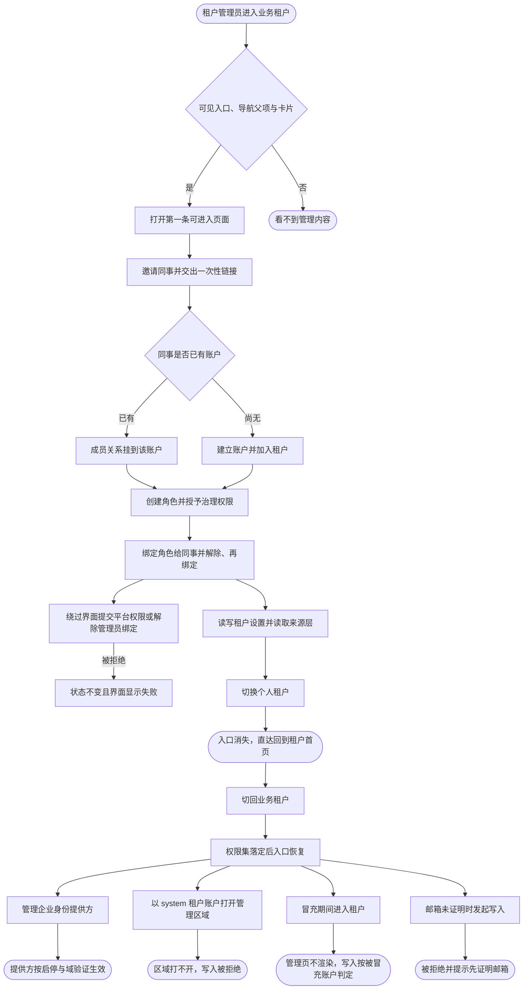

# 租户管理员接管一个业务租户的日常管理

## 参与者

- **租户管理员**：一个业务租户的成员，在该租户域持有 `tenant-admin` 角色，不持有任何平台域权限。该账户另有一个在加入业务租户之前取得的个人租户。
- **受邀同事**：被邀请加入该业务租户的同事。可以是已有账户，也可以在系统中尚无账户。
- **普通成员**：该业务租户的一名成员，不持有任何覆盖工作区管理页面的权限。
- **`system` 租户上的租户管理员**：在 `system` 租户持有 `tenant-admin` 的账户，用于验证 `system` 租户在工作区管理面不可管理。
- **冒充中的运营者**：持有平台域权限并已发起冒充的运营者，会话主体为被冒充账户并带冒充标记。
- **邮箱未证明的租户管理员**：在该业务租户持有 `tenant-admin`、但邮箱尚未证明的账户。

## 前置条件

- 目标业务租户已登记且处于启用状态，租户管理员是该租户的有效成员。
- 本部署装配了成员与邀请、企业身份提供方、租户设置与租户角色页面。
- 租户管理员的邮箱已证明。
- 租户管理员在该业务租户持有成员与邀请、租户设置与租户角色相关的治理权限。
- 该业务租户当前只有租户管理员一条 `tenant-admin` 绑定。
- 受邀同事的邮箱可由租户管理员取得；该同事尚未成为该业务租户的成员。
- 该业务租户另有一名普通成员，不持有任何覆盖工作区管理页面的权限。
- 本部署装配了企业身份提供方页面，且该业务租户可登记一个 OIDC 提供方。
- 另有一个在 `system` 租户持有 `tenant-admin` 的账户。
- 另有一个在该业务租户持有 `tenant-admin`、但邮箱尚未证明的账户。
- 另有运营者可在该业务租户发起冒充。

## 步骤

1. 租户管理员以本人账户登录，进入业务租户的租户区首页。页头或首页出现工作区管理面的入口与首页卡片，侧栏出现工作区管理面的导航父项。
2. 租户管理员激活入口或卡片，落到当前可进入的第一条工作区管理页面。入口与卡片落到同一页面，导航父项的子项是该账户可进入的页面集合。
3. 租户管理员打开邀请与成员页，查看成员区块。列表只含当前业务租户的成员，逐行显示账户标识、显示名、成员关系启用状态与成员关系来源，当前租户管理员也在其中。
4. 租户管理员在邀请区块填写同事的邮箱，签发邀请。签发成功后邀请列表出现一条待接受的邀请，页面在只显示一次的面板中给出接受链接与复制控件；关闭面板后链接不再显示。
5. 受邀同事打开接受链接。未登录时先看到登录面；登录或注册后看到被邀请的租户、地址与有效期，然后接受邀请，成为该业务租户的成员。
6. 租户管理员刷新邀请与成员页，看到该同事作为成员出现；邀请列表中该邀请的状态为已接受。
7. 租户管理员打开角色页，创建一个名为「支持」的非内建角色，并授予一项自己在当前租户持有、治理的权限。授予后该角色的授权中出现这项权限。
8. 租户管理员回到邀请与成员页的成员区块，选中刚加入的同事，把「支持」角色绑定给该同事。绑定成功后该同事的绑定列表出现该角色，并因此持有该角色的权限。租户管理员随后解除该绑定，绑定列表不再出现该角色；再次绑定后恢复。
9. 租户管理员绕过界面，直接提交一项平台域权限的授予请求，目标为「支持」角色。服务端拒绝该请求，该角色的授权不发生改变；界面把这次写入显示为失败，并仍然不显示该权限。端到端不可达：授予选择器只提供受治理的租户权限，页面没有提交平台域权限的控件；诚实门禁禁止直接调用接口，用例断言选择器不提供该权限。
10. 租户管理员在工作区管理面的角色页分别尝试创建一个名为 `platform-admin` 的角色、把 `platform-admin` 授予「支持」角色、把 `platform-admin` 绑定给该同事。三次尝试都被服务端拒绝，页面显示失败提示，当前租户的角色、授权与绑定都不变。端到端不可达的是把 `platform-admin` 授予「支持」角色这一分支：授予选择器只提供受治理的租户权限，页面无法把 `platform-admin` 作为授予目标；诚实门禁禁止直接调用接口，用例断言选择器不提供该角色。
11. 租户管理员尝试解除自己的 `tenant-admin` 绑定。界面显示失败提示，绑定仍在；该租户只有这一条 `tenant-admin` 绑定时，任何解除该绑定的尝试同样被拒绝。
12. 租户管理员打开设置页。页面按命名空间分组列出当前租户可见的设置项，每项显示键、类型、有效值与来源层；来源层取值是 `tenant`、`global` 或 `default`。租户管理员把一项允许租户写入的设置改为新值并保存；该项显示为租户层已覆盖，来源层为 `tenant`，有效值为新值。
13. 租户管理员尝试写入 `tenant.admission.*`、`authn.*` 与 `ratelimit.*` 下的设置键。三次尝试都被拒绝，租户层设置不发生改变，界面显示失败提示。端到端不可达：设置页只列出当前租户可写的设置项，平台专用命名空间没有可写控件；诚实门禁禁止直接调用接口，用例断言这些命名空间不出现。
14. 租户管理员切换到自己的个人租户。工作区管理面的入口、导航父项与首页卡片立即消失；直接打开工作区管理地址时，页面回到个人租户首页。
15. 租户管理员切回业务租户。新租户的权限集落定后，工作区管理面的入口、导航父项与首页卡片重新出现。
16. 普通成员登录并进入业务租户。该成员看不到工作区管理面的入口、导航父项与首页卡片；直接打开工作区管理地址时，页面静默回到租户首页，不显示重定向说明。
17. 租户管理员打开企业身份提供方页。列表只含当前租户的提供方，逐项给出协议、名称与启用状态。租户管理员登记一个 OIDC 提供方，它出现在当前租户的列表中，不出现在其他租户的列表；为它声明一个邮箱域并取得验证令牌，邮箱域的 DNS TXT 记录出现匹配内容后该域转为已验证并参与登录发现，声明一个已被另一个提供方验证的域被拒绝且双方状态不变；停用该提供方后，用该域邮箱发起的登录发现不再返回它，重新启用后再次返回；删除该提供方后它从列表消失，其邮箱域不再参与发现。
18. 以在 `system` 租户持有 `tenant-admin` 的账户打开 `system` 租户。工作区管理区域打不开，直达区域根与任一子路径都回到租户首页；发起任一租户管理写入都被拒绝，`system` 的角色、授权与绑定不变。写入分支端到端不可达：工作区管理区域不渲染，页面没有发起租户管理写入的控件；诚实门禁禁止直接调用接口。
19. 运营者发起冒充进入该业务租户。工作区管理面的入口、导航父项与首页卡片不出现，直达任一管理路径回到租户首页；同一会话直接发起的写入按被冒充账户在该租户的权限判定，被冒充账户不持相应权限时被拒绝。写入分支端到端不可达：冒充期间管理面不渲染，页面没有发起写入的控件；诚实门禁禁止直接调用接口。
20. 以一个邮箱未证明的租户管理员从工作区管理面分别发起成员、邀请、SSO、角色、授权、绑定与设置写入，每次都被拒绝并提示先证明邮箱，目标数据不变；该账户证明邮箱后同一写入成功。

## 结果

- 受邀同事是该业务租户的成员，并持有「支持」角色及其治理权限。
- 角色页中存在「支持」角色，其授权只含租户管理员授予的治理权限；平台域权限没有被授予。
- 租户管理员的 `tenant-admin` 绑定仍在，该租户至少保留一条 `tenant-admin` 绑定。
- 设置页中该项显示租户层已覆盖、来源层为 `tenant`，当前租户读到新值，其他租户不受影响；平台专用命名空间下的设置键没有被租户层覆盖。
- 个人租户中不出现工作区管理入口、导航父项与首页卡片；切回业务租户并落定后按新权限集重新出现。
- 普通成员和直达工作区管理地址的非管理员都落到租户首页，看不到工作区管理内容。
- 被拒绝的授权、`platform-admin` 的创建/授予/绑定与解绑尝试都没有改变角色、授权或绑定，界面显示失败提示，审计中没有这些动作的成功记录。
- 企业身份提供方按登记、域验证、启停与删除各自生效；停用的提供方不参与登录发现，删除后其邮箱域不再参与发现。
- `system` 租户打不开工作区管理区域，其上的租户管理写入被拒绝；冒充期间管理页面不渲染，写入按被冒充账户的权限判定；邮箱未证明的租户管理员的写入被拒绝，证明后同一写入成功。

## 备选路径

- **受邀同事已有账户**：接受邀请后，成员关系挂到该邮箱对应的账户，不建立第二个账户。
- **受邀同事尚无账户**：接受页要求填写显示名与口令，接受后建立账户并把它加入业务租户，该邮箱成为新账户的已验证邮箱。
- **邀请被撤销**：租户管理员在邀请列表中撤销一条待接受的邀请后，该链接不能再被接受；受邀同事再次打开链接得到邀请已失效的结果，不产生成员关系。
- **同事先被移除再重新邀请**：租户管理员经工作区管理面移除该同事后，该同事带着该租户的业务请求得到与非成员相同的不可访问结果；重新签发并接受后再次成为成员。该同事持有该租户最后一条 `tenant-admin` 绑定时，移除被拒绝。
- **在工作区管理区域切换租户**：租户管理员在邀请与成员页切换租户时，页面落到新租户首页，工作区管理面的入口在新权限集落定前不出现；若新租户没有可进入页面，入口保持不出现。
- **账户只覆盖部分工作区管理页面**：账户直达它没有权限的页面时，落到它可进入的第一条页面；一条可进入页面也没有时，落到当前租户首页。
- **部署未装配工作区管理页面**：入口、导航父项与首页卡片都不出现；直达区域根与任一子路径都落到当前租户首页，且不发出工作区管理页面的读取。
- **审计存储不可用**：租户管理员从工作区管理面分别发起成员、邀请、SSO、角色、授权、绑定与设置写入，每次都因依赖不可用而失败，目标数据不变，界面显示失败提示；审计恢复后同一写入成功并留下成功记录。

## 覆盖的需求

- `REQ-tenant-admin-001`
- `REQ-tenant-admin-002`
- `REQ-tenant-admin-003`
- `REQ-tenant-admin-004`
- `REQ-tenant-admin-005`
- `REQ-tenant-admin-006`
- `REQ-tenant-admin-007`
- `REQ-tenant-admin-008`
- `REQ-tenant-admin-009`
- `REQ-tenant-admin-010`
- `REQ-tenant-admin-011`
- `REQ-tenant-admin-012`
- `REQ-tenant-admin-013`
- `REQ-tenant-admin-014`
- `REQ-tenant-admin-015`
- `REQ-tenant-admin-016`
- `REQ-tenant-admin-017`
- `REQ-tenant-admin-019`
- `REQ-tenant-admin-022`
- `REQ-tenant-admin-023`
- `REQ-tenant-admin-026`
- `REQ-tenant-admin-027`
- `REQ-tenant-admin-029`
- `REQ-tenant-admin-030`
- `REQ-tenant-admin-031`
- `REQ-tenant-admin-032`
- `REQ-tenant-admin-033`
- `REQ-tenant-admin-034`
- `REQ-tenant-admin-035`
- `REQ-tenant-admin-037`
- `REQ-tenant-admin-040`
- `REQ-tenant-admin-041`
- `REQ-tenant-admin-042`
- `REQ-tenant-admin-043`
- `REQ-tenant-admin-045`
- `REQ-tenant-admin-046`
- `REQ-tenant-admin-047`
- `REQ-tenant-admin-048`
- `REQ-tenant-admin-049`
- `REQ-tenant-admin-050`
- `REQ-tenancy-008`
- `REQ-tenancy-009`
- `REQ-tenancy-010`
- `REQ-tenancy-011`
- `REQ-tenancy-013`
- `REQ-tenancy-014`
- `REQ-tenancy-015`
- `REQ-tenancy-016`
- `REQ-tenancy-017`
- `REQ-tenancy-018`
- `REQ-tenancy-020`
- `REQ-tenancy-021`
- `REQ-tenancy-035`

## 端到端测试

`starters/demo/web/e2e/specs/journey-tenant-admin.spec.ts` `tenant-admin: the administrator invites, governs and switches the workspace` 覆盖入口、导航与首页卡片、邀请与成员、角色与授权、绑定、设置与租户切换；`tenant-admin: the workspace registers, verifies, disables and removes an SSO provider` 覆盖企业身份提供方的登记、域验证、启停与删除；`tenant-admin: the system tenant shows no entry and every direct visit returns home` 覆盖 `system` 租户不出现入口且直达管理地址回到租户首页；`tenant-admin: impersonating the administrator renders no workspace surface` 覆盖冒充期间管理面不渲染；`tenant-admin: the unproved administrator is refused, proves the address and retries` 覆盖邮箱未证明时写入被拒绝、证明后同一写入成功。
