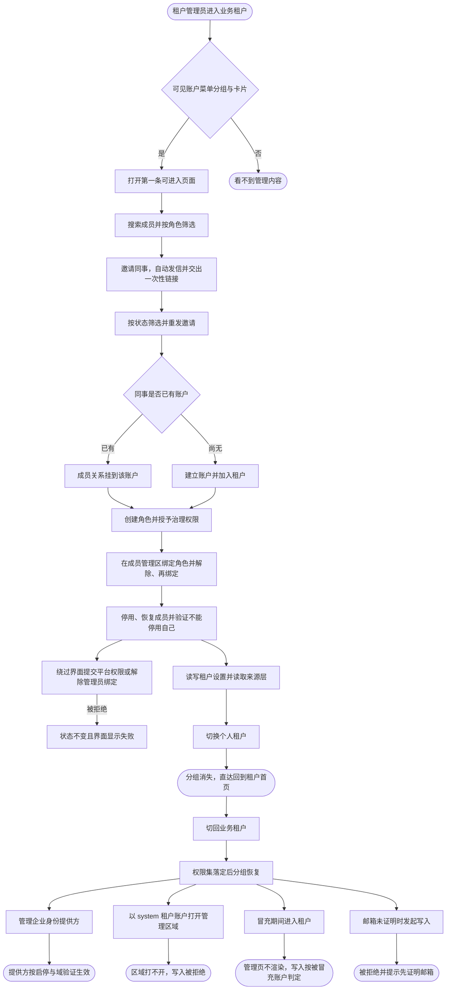

# 租户管理员接管一个业务租户的日常管理

## 参与者

- **租户管理员**：一个业务租户的成员，在该租户域持有 `tenant-admin` 角色，不持有任何平台域权限。该账户另有一个在加入业务租户之前取得的个人租户。
- **受邀同事**：被邀请加入该业务租户的同事。可以是已有账户，也可以在系统中尚无账户。
- **普通成员**：该业务租户的一名成员，不持有任何覆盖组织管理页面的权限。
- **`system` 租户上的租户管理员**：在 `system` 租户持有 `tenant-admin` 的账户，用于验证 `system` 租户在组织管理面不可管理。
- **冒充中的运营者**：持有平台域权限并已发起冒充的运营者，会话主体为被冒充账户并带冒充标记。
- **邮箱未证明的租户管理员**：在该业务租户持有 `tenant-admin`、但邮箱尚未证明的账户。

## 前置条件

- 目标业务租户已登记且处于启用状态，租户管理员是该租户的有效成员。
- 本部署装配了成员与邀请、企业身份提供方、租户设置与租户角色页面。
- 租户管理员的邮箱已证明。
- 租户管理员在该业务租户持有成员与邀请、租户设置与租户角色相关的治理权限。
- 该业务租户当前只有租户管理员一条 `tenant-admin` 绑定。
- 本部署配置了邀请通知邮件，邮件内容可从测试日志读取。
- 受邀同事的邮箱可由租户管理员取得；该同事尚未成为该业务租户的成员。
- 该业务租户另有一名普通成员，不持有任何覆盖组织管理页面的权限。
- 本部署装配了企业身份提供方页面，且该业务租户可登记一个 OIDC 提供方。
- 另有一个在 `system` 租户持有 `tenant-admin` 的账户。
- 另有一个在该业务租户持有 `tenant-admin`、但邮箱尚未证明的账户。
- 另有运营者可在该业务租户发起冒充。

## 步骤

1. 租户管理员以本人账户登录，进入业务租户的租户区首页。头像账户菜单与侧栏账户菜单出现组织管理面的分组，分组以「组织管理」为可访问名称；首页出现组织管理面的卡片。
2. 租户管理员激活分组中的首条链接或卡片，落到当前可进入的第一条组织管理页面。首条链接与卡片落到同一页面，分组列出的链接是该账户可进入的页面集合。
3. 租户管理员打开成员与邀请页，查看成员分区。列表只含当前业务租户的成员，逐行显示显示名、账户、角色、状态、来源与加入时间，当前租户管理员也在其中；持有多个角色的成员显示全部角色名，没有角色的成员显示占位。
4. 租户管理员在成员搜索框输入同事显示名或登录标识的前缀，列表收窄到匹配成员；输入没有匹配的前缀时显示搜索空态，清空搜索后恢复全部成员。
5. 租户管理员按角色筛选成员，列表只含持有该角色的成员；带角色参数的地址直接打开同一筛选视图；清除筛选后恢复未筛选，地址中的角色参数随之移除。
6. 租户管理员在邀请区填写同事的邮箱与过期时间（或选择 1 天、7 天、30 天快捷项），签发邀请。签发成功后系统向该地址发送含接受链接的通知邮件，邀请列表出现一条待接受的邀请；一次性面板显示接受地址、有效期、任何获得链接的人都能加入本租户的提示与投递结果，并提供复制控件；关闭面板前要求确认，确认后链接不再显示。
7. 租户管理员按待接受、已过期、已接受与已撤销筛选邀请。已过期的待接受邀请显示为已过期，仍以待接受存储。租户管理员对这条待接受邀请点重发，确认后旧链接失效，新链接进入一次性面板并被邮件投递；待接受筛选下只有新的邀请，已撤销筛选下出现被替代的旧邀请。
8. 受邀同事打开一次性面板给出的链接或邮件中的链接，两者指向同一条邀请。未登录时先看到登录面；登录或注册后看到被邀请的租户、地址与有效期，然后接受邀请，成为该业务租户的成员。
9. 租户管理员刷新成员与邀请页，看到该同事作为成员出现，成员行显示其角色与加入时间；邀请列表中该邀请的状态为已接受。
10. 租户管理员打开角色页，创建一个名为「支持」的非内建角色，并授予一项自己在当前租户持有、治理的权限。授予后该角色的授权中出现这项权限。
11. 租户管理员回到成员与邀请页，打开刚加入同事的管理区。管理区列出该同事在当前租户的角色绑定；绑定「支持」角色后绑定列表出现该角色，该同事因此持有该角色的权限；解除后绑定列表不再出现该角色，再次绑定后恢复。
12. 租户管理员在管理区停用该同事，确认文案说明该同事将暂时无法访问本组织、角色绑定保留且可随时恢复。停用后该同事带着该租户的业务请求得到与非成员相同的不可访问结果，成员列表仍包含它且角色绑定仍在；恢复后访问与权限恢复。
13. 租户管理员打开自己的管理区。停用控件不可用并说明不能停用自己；绕过界面直接发起停用自己得到专用错误，成员关系保持启用。
14. 租户管理员绕过界面，直接提交一项平台域权限的授予请求，目标为「支持」角色。服务端拒绝该请求，该角色的授权不发生改变；界面把这次写入显示为失败，并仍然不显示该权限。端到端不可达：授予选择器只提供受治理的租户权限，页面没有提交平台域权限的控件；诚实门禁禁止直接调用接口，用例断言选择器不提供该权限。
15. 租户管理员在组织管理面的角色页分别尝试创建一个名为 `platform-admin` 的角色、把 `platform-admin` 授予「支持」角色、把 `platform-admin` 绑定给该同事。三次尝试都被服务端拒绝，页面显示失败提示，当前租户的角色、授权与绑定都不变。端到端不可达的是把 `platform-admin` 授予「支持」角色这一分支：授予选择器只提供受治理的租户权限，页面无法把 `platform-admin` 作为授予目标；诚实门禁禁止直接调用接口，用例断言选择器不提供该角色。
16. 租户管理员尝试解除自己的 `tenant-admin` 绑定。界面显示失败提示，绑定仍在；该租户只有这一条 `tenant-admin` 绑定时，任何解除该绑定的尝试同样被拒绝。
17. 租户管理员打开设置页。页面按命名空间分组列出当前租户可见的设置项，每项显示键、类型、有效值与来源层；来源层取值是 `tenant`、`global` 或 `default`。租户管理员把一项允许租户写入的设置改为新值并保存；该项显示为租户层已覆盖，来源层为 `tenant`，有效值为新值。
18. 租户管理员尝试写入 `tenant.admission.*`、`authn.*` 与 `ratelimit.*` 下的设置键。三次尝试都被拒绝，租户层设置不发生改变，界面显示失败提示。端到端不可达：设置页只列出当前租户可写的设置项，平台专用命名空间没有可写控件；诚实门禁禁止直接调用接口，用例断言这些命名空间不出现。
19. 租户管理员切换到自己的个人租户。组织管理面的账户菜单分组与首页卡片立即消失；直接打开组织管理地址时，页面回到个人租户首页。
20. 租户管理员切回业务租户。新租户的权限集落定后，组织管理面的账户菜单分组与首页卡片重新出现。
21. 普通成员登录并进入业务租户。该成员看不到组织管理面的账户菜单分组与首页卡片；直接打开组织管理地址时，页面静默回到租户首页，不显示重定向说明。
22. 租户管理员打开企业身份提供方页。列表只含当前租户的提供方，逐项给出协议、名称与启用状态。租户管理员登记一个 OIDC 提供方，它出现在当前租户的列表中，不出现在其他租户的列表；为它声明一个邮箱域并取得验证令牌，邮箱域的 DNS TXT 记录出现匹配内容后该域转为已验证并参与登录发现，声明一个已被另一个提供方验证的域被拒绝且双方状态不变；停用该提供方后，用该域邮箱发起的登录发现不再返回它，重新启用后再次返回；删除该提供方后它从列表消失，其邮箱域不再参与发现。
23. 以在 `system` 租户持有 `tenant-admin` 的账户打开 `system` 租户。组织管理区域打不开，直达区域根与任一子路径都回到租户首页；发起任一租户管理写入都被拒绝，`system` 的角色、授权与绑定不变。写入分支端到端不可达：组织管理区域不渲染，页面没有发起租户管理写入的控件；诚实门禁禁止直接调用接口。
24. 运营者发起冒充进入该业务租户。组织管理面的账户菜单分组与首页卡片不出现，直达任一管理路径回到租户首页；同一会话直接发起的写入按被冒充账户在该租户的权限判定，被冒充账户不持相应权限时被拒绝。写入分支端到端不可达：冒充期间管理面不渲染，页面没有发起写入的控件；诚实门禁禁止直接调用接口。
25. 以一个邮箱未证明的租户管理员从组织管理面分别发起成员、邀请、SSO、角色、授权、绑定与设置写入，每次都被拒绝并提示先证明邮箱，目标数据不变；该账户证明邮箱后同一写入成功。

## 结果

- 成员列表逐行显示显示名、账户、角色、状态、来源与加入时间；文本搜索与角色筛选可用，角色筛选可经地址中的角色参数直达。
- 受邀同事是该业务租户的成员，并持有「支持」角色及其治理权限。
- 邀请按待接受、已过期、已接受与已撤销筛选；重发后旧链接失效，新链接经一次性面板与通知邮件送达；一次性面板关闭前要求确认，只有当前签发或重发的邀请提供复制链接。
- 停用成员保留其角色绑定，恢复后访问与权限恢复；停用自己的尝试被专用错误拒绝，页面在操作前已禁用并说明原因。
- 移除成员的确认文案说明会清除全部角色绑定且不可撤销；最后管理员冲突在失败提示旁说明必须保留至少一名活跃的 `tenant-admin`。
- 角色页中存在「支持」角色，其授权只含租户管理员授予的治理权限；平台域权限没有被授予。
- 租户管理员的 `tenant-admin` 绑定仍在，该租户至少保留一条 `tenant-admin` 绑定。
- 设置页中该项显示租户层已覆盖、来源层为 `tenant`，当前租户读到新值，其他租户不受影响；平台专用命名空间下的设置键没有被租户层覆盖。
- 个人租户中不出现组织管理的账户菜单分组与首页卡片；切回业务租户并落定后按新权限集重新出现。
- 普通成员和直达组织管理地址的非管理员都落到租户首页，看不到组织管理内容。
- 被拒绝的授权、`platform-admin` 的创建/授予/绑定与解绑尝试都没有改变角色、授权或绑定，界面显示失败提示，审计中没有这些动作的成功记录。
- 企业身份提供方按登记、域验证、启停与删除各自生效；停用的提供方不参与登录发现，删除后其邮箱域不再参与发现。
- `system` 租户打不开组织管理区域，其上的租户管理写入被拒绝；冒充期间管理页面不渲染，写入按被冒充账户的权限判定；邮箱未证明的租户管理员的写入被拒绝，证明后同一写入成功。

## 备选路径

- **受邀同事已有账户**：接受邀请后，成员关系挂到该邮箱对应的账户，不建立第二个账户。
- **受邀同事尚无账户**：接受页要求填写显示名与口令，接受后建立账户并把它加入业务租户，该邮箱成为新账户的已验证邮箱。
- **邀请被撤销**：租户管理员在邀请列表中撤销一条待接受的邀请后，该链接不能再被接受；受邀同事再次打开链接得到邀请已失效的结果，不产生成员关系。
- **邀请邮件投递失败**：签发仍成功，一次性面板显示投递失败并保留接受链接；租户管理员改用复制链接转交，受邀人仍可接受。
- **重发邀请**：租户管理员对一条待接受或已过期的邀请重发后，旧链接不能再被接受，新链接同时出现在一次性面板与通知邮件中；已接受与已撤销的邀请重发只新增一条待接受邀请，不改变原邀请的终态。
- **按角色筛选的深链**：租户管理员打开带角色参数的成员页地址，直接看到该角色的筛选视图；参数中的角色没有任何成员持有时显示与筛选对应的空态，不显示租户没有成员。
- **同事先被移除再重新邀请**：租户管理员经组织管理面移除该同事后，该同事带着该租户的业务请求得到与非成员相同的不可访问结果；重新签发并接受后再次成为成员。移除前出现比停用更重的双重确认，文案说明清除全部角色绑定且不可撤销。该同事持有该租户最后一条 `tenant-admin` 绑定时，移除得到通用冲突，页面在失败提示旁说明必须保留至少一名活跃的 `tenant-admin`。
- **在组织管理区域切换租户**：租户管理员在邀请与成员页切换租户时，页面落到新租户首页，组织管理面的账户菜单分组在新权限集落定前不出现；若新租户没有可进入页面，分组保持不出现。
- **账户只覆盖部分组织管理页面**：账户直达它没有权限的页面时，落到它可进入的第一条页面；一条可进入页面也没有时，落到当前租户首页。
- **部署未装配组织管理页面**：账户菜单分组与首页卡片都不出现；直达区域根与任一子路径都落到当前租户首页，且不发出组织管理页面的读取。
- **审计存储不可用**：租户管理员从组织管理面分别发起成员、邀请、SSO、角色、授权、绑定与设置写入，每次都因依赖不可用而失败，目标数据不变，界面显示失败提示；审计恢复后同一写入成功并留下成功记录。

## 覆盖的需求

- `REQ-tenant-admin-001`
- `REQ-tenant-admin-002`
- `REQ-tenant-admin-003`
- `REQ-tenant-admin-004`
- `REQ-tenant-admin-005`
- `REQ-tenant-admin-006`
- `REQ-tenant-admin-007`
- `REQ-tenant-admin-008`
- `REQ-tenant-admin-009`
- `REQ-tenant-admin-010`
- `REQ-tenant-admin-011`
- `REQ-tenant-admin-012`
- `REQ-tenant-admin-013`
- `REQ-tenant-admin-014`
- `REQ-tenant-admin-015`
- `REQ-tenant-admin-016`
- `REQ-tenant-admin-017`
- `REQ-tenant-admin-019`
- `REQ-tenant-admin-022`
- `REQ-tenant-admin-023`
- `REQ-tenant-admin-026`
- `REQ-tenant-admin-027`
- `REQ-tenant-admin-029`
- `REQ-tenant-admin-030`
- `REQ-tenant-admin-031`
- `REQ-tenant-admin-032`
- `REQ-tenant-admin-033`
- `REQ-tenant-admin-034`
- `REQ-tenant-admin-035`
- `REQ-tenant-admin-037`
- `REQ-tenant-admin-040`
- `REQ-tenant-admin-041`
- `REQ-tenant-admin-042`
- `REQ-tenant-admin-043`
- `REQ-tenant-admin-045`
- `REQ-tenant-admin-046`
- `REQ-tenant-admin-047`
- `REQ-tenant-admin-048`
- `REQ-tenant-admin-049`
- `REQ-tenant-admin-050`
- `REQ-tenant-admin-051`
- `REQ-tenant-admin-052`
- `REQ-tenant-admin-053`
- `REQ-tenant-admin-054`
- `REQ-tenant-admin-055`
- `REQ-tenant-admin-056`
- `REQ-tenant-admin-057`
- `REQ-tenant-admin-058`
- `REQ-tenant-admin-059`
- `REQ-tenant-admin-060`
- `REQ-tenant-admin-061`
- `REQ-tenancy-008`
- `REQ-tenancy-009`
- `REQ-tenancy-010`
- `REQ-tenancy-011`
- `REQ-tenancy-013`
- `REQ-tenancy-014`
- `REQ-tenancy-015`
- `REQ-tenancy-016`
- `REQ-tenancy-017`
- `REQ-tenancy-018`
- `REQ-tenancy-020`
- `REQ-tenancy-021`
- `REQ-tenancy-035`
- `REQ-tenancy-051`
- `REQ-tenancy-052`
- `REQ-tenancy-053`
- `REQ-tenancy-054`
- `REQ-tenancy-055`
- `REQ-tenancy-056`
- `REQ-tenancy-057`
- `REQ-tenancy-058`

## 端到端测试

`starters/demo/web/e2e/specs/journey-tenant-admin.spec.ts` `tenant-admin: the administrator invites, governs and switches the organization` 覆盖账户菜单分组与首页卡片、成员搜索与角色筛选、邀请签发/筛选/重发/撤销与一次性面板、角色与授权、成员管理区的绑定与解绑、停用与恢复、停用自己拒绝、移除、设置与租户切换；邀请通知邮件的链接从邮件日志读取并与一次性面板比对；`tenant-admin: the organization registers, verifies, disables and removes an SSO provider` 覆盖企业身份提供方的登记、域验证、启停与删除；`tenant-admin: the system tenant shows no entry and every direct visit returns home` 覆盖 `system` 租户不出现入口且直达管理地址回到租户首页；`tenant-admin: impersonating the administrator renders no organization surface` 覆盖冒充期间管理面不渲染；`tenant-admin: the unproved administrator is refused, proves the address and retries` 覆盖邮箱未证明时写入被拒绝、证明后同一写入成功。
