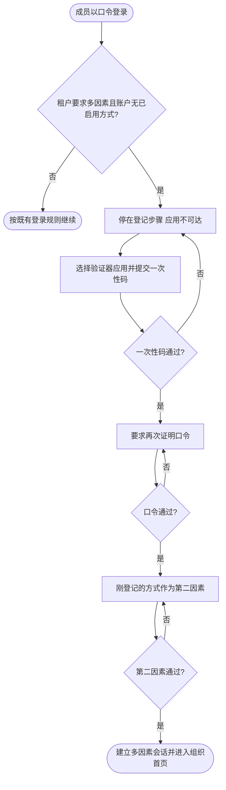

# 租户要求多因素认证时的登录内登记

## 参与者

- **成员**：业务租户的 active 成员，账户持有口令登录名，尚未登记任何已启用的两步验证方式。该租户的多因素认证要求已生效。

## 前置条件

- 目标业务租户已登记且处于启用状态。
- 该租户的准入设置 `tenant.admission.require-mfa` 有效值为真：平台层或该租户层至少一层显式写下了真。
- 成员是该租户的 active 成员，并持有可用的口令登录名。
- 成员的账户没有任何已启用的两步验证方式。
- 本部署装配了认证、租户准入与验证器应用（TOTP）因素，并声明了该因素的种类。

## 步骤

1. 成员在登录页以用户名与口令登录。
2. 系统不完成登录，而是停在登记步骤：页面要求成员先登记一个两步验证方式，应用其余部分不可达。
3. 成员选择验证器应用。页面给出二维码、设置密钥与六位码输入框。
4. 成员用认证器应用扫描二维码或手动输入设置密钥，再把应用显示的一次性码填入并提交。
5. 系统不把这次登记当作登录完成，而是要求成员再次输入用户名与口令。
6. 成员再次证明口令。
7. 系统把本次登录刚登记的验证器应用列为第二因素。成员选择它，输入认证器应用此时显示的六位码并提交。
8. 系统建立多因素会话，成员进入组织首页。成员随后进入该租户时，租户的多因素准入要求已经满足。

## 结果

- 登录在登记、口令重证与第二因素通过之后才完成，会话为多因素；登记完成与第二因素通过之间没有会话，应用其余部分不可达。
- 刚登记的因素在口令重证之后才作为第二因素使用，本次登录的强度不来自登记本身，而来自重证之后的那次使用。
- 成员能进入要求多因素认证的租户；请求期的准入判定读到的是该会话已记录的多因素强度。

## 备选路径

- **登记的一次性码不通过**：流程停在登记步骤，成员可原地重试；在确认码通过之前登记不生效。
- **口令重证不通过**：流程停在重证步骤并指出口令不符，成员可原地重试；登录不完成。
- **第二因素不通过**：流程停在第二因素步骤，成员可重试或改选其它已启用方式；登录不完成。
- **成员在流程外已经持有已启用的两步验证方式**：登录不进入强制登记，按既有的第二因素规则继续。
- **租户的要求在流程开始之前并未生效**：登录不进入强制登记；要求只约束生效之后的登录，不追溯已经建立的会话。

## 覆盖的需求

- 账户安全：`REQ-security-008`、`REQ-security-010`、`REQ-security-046`

## 端到端测试

`starters/demo/web/e2e/specs/journey-tenant-required-mfa-enrollment.spec.ts` `tenant-required-mfa-enrollment: a required factor is enrolled, the password proved again, and the new factor used before the session exists`
