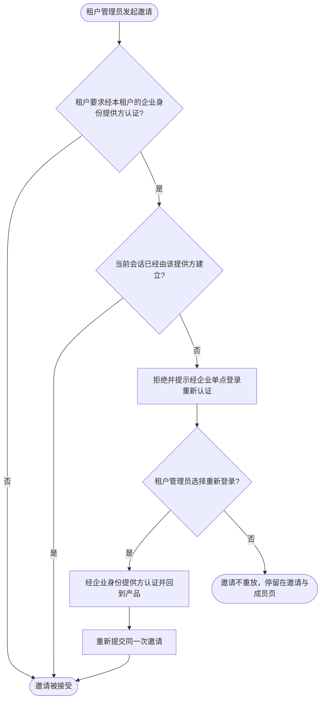

# 租户要求单点登录时的重新认证

## 参与者

- **租户管理员**：目标租户的成员，持有该租户的成员与邀请管理权限，工作邮箱域已由该租户的企业身份提供方验证。

## 前置条件

- 目标租户已登记且启用；平台运营者已为该租户启用企业单点登录要求，并登记了一个启用的企业身份提供方（OIDC 或 SAML），其企业邮箱域已验证。
- 该租户的准入设置要求成员经该租户的企业身份提供方认证。
- 租户管理员的当前会话由本地第一因素建立（口令，可能加本地第二因素），不是经该租户的企业身份提供方建立的。
- 租户管理员持有该租户的成员与邀请管理权限。

## 步骤

1. 租户管理员打开该租户的「邀请与成员」页，发起一次邀请。
2. 系统拒绝这次邀请，并告知该租户要求经企业单点登录重新认证；界面不打开本地两步验证方式的加强认证对话框，也不列出本地两步验证方式。
3. 租户管理员选择重新登录；当前会话结束，登录页出现。
4. 租户管理员在登录页选择企业登录，输入工作邮箱，选择所属组织，在企业身份提供方完成认证，回到产品。
5. 租户管理员回到「邀请与成员」页，重新提交同一次邀请；邀请成功，确认文案与直接提交相同；被邀请地址收到邀请。

## 结果

- 邀请在重新登录后被接受并生效，租户管理员得到与直接提交相同的成功确认；被邀请地址收到邀请。
- 会话由该租户的企业身份提供方建立，租户的强制单点登录要求得到满足。
- 界面从未提供本地两步验证方式的加强认证入口；拒绝文案点名企业单点登录。

## 备选路径

- **租户管理员取消重新登录**：这次邀请不重放，邀请与成员页保持原状；之后重新发起邀请时，系统再次给出同一个出口。
- **租户的企业身份提供方不可用或被停用**：租户的强制单点登录要求无法满足，系统拒绝这次邀请；租户管理员联系提供方管理员恢复。本地两步验证方式不能替代这一要求。
- **当前会话已经由该租户的企业身份提供方建立**：租户的强制单点登录要求已满足，邀请按正常流程受理。

## 覆盖的需求

- 组织与成员：`REQ-tenancy-008`、`REQ-tenancy-011`、`REQ-tenancy-013`、`REQ-tenancy-015`、`REQ-tenancy-016`、`REQ-tenancy-017`、`REQ-tenancy-018`、`REQ-tenancy-019`、`REQ-tenancy-020`、`REQ-tenancy-021`、`REQ-tenancy-035`、`REQ-tenancy-043`
- 账户安全：`REQ-security-038`
- 登录：`REQ-signin-020`、`REQ-signin-021`、`REQ-signin-022`、`REQ-signin-023`

## 端到端测试

`starters/demo/web/e2e/specs/journey-tenant-sso-required.spec.ts` `tenant-sso-required: a member re-invites a colleague through the tenant's enterprise SSO after the tenant demands it`
