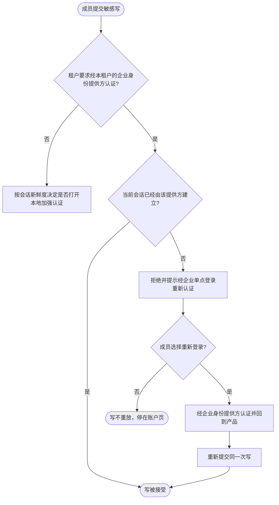

# 租户要求单点登录时的重新认证

## 参与者

- **租户成员**：目标租户的成员，名下已启用口令凭据与至少一种两步验证方式，持有更改口令、增删登录标识、增删两步验证方式等敏感写的权限。

## 前置条件

- 目标租户已登记且启用；平台运营者已为该租户启用企业单点登录要求，并登记了一个启用的企业身份提供方（OIDC 或 SAML），其企业邮箱域已验证。
- 该租户的准入设置要求成员经该租户的企业身份提供方认证。
- 租户成员的当前会话由本地第一因素建立（口令，可能加本地第二因素），不是经该租户的企业身份提供方建立的。
- 租户成员持有本次敏感写所需的权限。

## 步骤

1. 租户成员打开账户页，提交一次要求新鲜认证的敏感写，例如把口令改为新口令。
2. 系统拒绝这次写，并告知该租户要求经企业单点登录重新认证；界面不打开本地两步验证方式的加强认证对话框，也不列出本地两步验证方式。
3. 租户成员选择重新登录；当前会话结束，登录页出现。
4. 租户成员在登录页选择企业登录，输入工作邮箱，选择所属组织，在企业身份提供方完成认证，回到产品。
5. 租户成员回到账户页，重新提交同一次敏感写。

## 结果

- 敏感写在重新登录后被接受并生效，成员得到与直接提交相同的成功确认。
- 会话由该租户的企业身份提供方建立，租户的强制单点登录要求得到满足。
- 界面从未提供本地两步验证方式的加强认证入口；拒绝文案点名企业单点登录。

## 备选路径

- **成员取消重新登录**：这次写不重放，账户页保持原值；成员之后重新做这次写时，系统再次给出同一个出口。
- **租户的企业身份提供方不可用或被停用**：租户的强制单点登录要求无法满足，系统拒绝这次写；成员联系租户管理员恢复提供方。本地两步验证方式不能替代这一要求。
- **当前会话已经由该租户的企业身份提供方建立**：租户的强制单点登录要求已满足，按会话新鲜度决定是否还需要本地加强认证。

## 覆盖的需求

- 账户安全：`REQ-security-013`、`REQ-security-014`、`REQ-security-017`、`REQ-security-038`
- 登录：`REQ-signin-020`、`REQ-signin-021`、`REQ-signin-022`、`REQ-signin-023`

## 端到端测试

未实现
